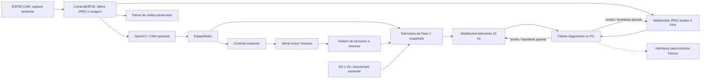

# Etapa 2 — comunicação observacional Raspberry ↔ computador

Implementação de 25/11/2026, sobre o commit local `76d67b3` da Fase 1.
Hardware indisponível: testes com sockets localhost reais e dados simulados no
Windows, sem serial física, ESP32, serviço da Pi ou movimento real.
Não há banco SQLite, dashboard definitivo, renderização 3D, inferência externa
ou controle externo nesta entrega. Nenhum push foi autorizado/executado.

## Arquitetura e decisão técnica

Biblioteca `websockets` assíncrona, versão validada 14.2, sem FastAPI/ASGI.
O painel atual usa `ThreadingHTTPServer`, sem infraestrutura WebSocket. Foi
preservado em sua porta e finalidade; misturar os dois servidores aumentaria
o acoplamento. Uma thread com event loop atende o novo transporte. Threads de
snapshot e SO mantêm consultas potencialmente lentas fora do loop e do controle.
Não foi necessário adicionar framework web, treinamento ou visualização à Pi.



O servidor recebe apenas um provedor de snapshots e a referência opcional à
**mesma** `CameraESP32` criada pela main. Não recebe motor ou controle, não
importa serial e não possui dispatcher de movimento. O cliente também não
tem acesso à serial. Conectar, desconectar ou reconectar não altera modo nem
interrompe autonomia embarcada. `REDE_ATIVA=False`: a configuração padrão
continua sendo a operação embarcada anterior.

Sem benchmark em disco, `Amostras` reutiliza `Telemetria`, `Sistema` e `Registro`
da Fase 1 para observar recursos e tempos em memória. Com `--benchmark`,
reutiliza o cache de SO/tempos do benchmark, evitando outra coleta de SO e outro
dreno do registro. Snapshots de telemetria usam uma instância própria porque
o cálculo por delta de encoders tem frequência diferente (10 Hz versus 1 Hz).
Isso não abre outra serial nem captura imagens. Falha no benchmark pode deixar
suas métricas vencidas; `sistema_estado`/idade deixam isso explícito.

## Arquivos e dependências

Novos módulos:

| Arquivo | Responsabilidade |
|---|---|
| `comunicacao/configuracao.py` | Parâmetros centrais validados e limites |
| `comunicacao/protocolo.py` | Envelope JSON, validação, sequência e pacote JPEG |
| `comunicacao/metricas.py` | RTT, jitter, contadores e taxas com memória limitada |
| `comunicacao/amostras.py` | Snapshots 10 Hz e recursos 1 Hz, reutilizando Fase 1 |
| `comunicacao/servidor.py` | Autenticação, dois canais, heartbeat e filas por consumidor |
| `comunicacao/cliente.py` | Reconexão, validação, temporalidade e interface de consumo |
| `comunicacao/simulacao.py` | Cenários isolados com FonteSimulada/ArduinoNulo |
| `tools/rede_servidor_simulado.py` | Servidor local com injeção explícita de falhas |
| `tools/rede_cliente.py` | Diagnóstico textual no PC |
| `tools/testar_rede_carga.py` | Quatro cenários automatizados, JSON/CSV de resultados |
| `tools/rede_simulada.ps1`, `tools/rede_diagnostico.ps1` | Inicializadores Windows |
| `tests/test_comunicacao.py` | Testes de protocolo, integração, falhas e isolamento |

Modificados: `main.py` (inicialização/limpeza opt-in), `config.py` (parâmetros),
`monitoramento/benchmark.py` (cache e métricas de rede), `.gitignore`, README e
contexto de continuidade. Firmware, parâmetros PI/PD, Bluetooth, detector,
captura ESP32 e painel de coleta não foram alterados nesta etapa.

- Pi: `requirements-rede-pi.txt`: `websockets>=14.2,<15` e psutil opcional já
  usado pelo benchmark. NumPy/OpenCV/serial continuam dependências existentes
  do robô, sem novas bibliotecas de treinamento ou visualização.
- PC: `requirements-rede-pc.txt`: websockets, psutil e NumPy/OpenCV para servidor
  simulado/carga. **Somente o cliente** precisa apenas de websockets; ele não
  importa OpenCV, NumPy ou serial. Não há dependência do Blender/Three.js.

## Endpoints e formato

Uma porta configurável (`REDE_PORTA`, inicialmente 8765), com duas conexões TCP
independentes por cliente:

| Endpoint | Servidor → PC | PC → servidor |
|---|---|---|
| `/ws/telemetria` | `ola`, `eco`, `telemetria` em JSON UTF-8 | `sonda` diagnóstica autenticada |
| `/ws/imagens` | `ola`/`eco` JSON; imagens em mensagens binárias | `sonda` diagnóstica autenticada |

Token obrigatório no handshake: `Authorization: Bearer TOKEN`, com pelo menos
24 caracteres. Obtido exclusivamente de `ROBO_REDE_TOKEN` (nome configurável),
não pela URL. Nenhum token é incluído na telemetria ou nos relatórios. Origins
de navegador são recusados nesta etapa; o cliente nativo envia sem Origin.
Endpoints desconhecidos: 404; token incorreto: 401; excesso de consumidores: 503.

Envelope de exemplo conceitual (IDs e números ilustrativos):

```json
{
  "versao": 1,
  "sessao": "00000000-0000-4000-8000-000000000001",
  "sequencia": 12,
  "tipo": "telemetria",
  "origem": "simulador",
  "simulado": true,
  "timestamp": "2026-11-25T16:00:00+00:00",
  "monotonic_s": 123.4,
  "idade_envio_s": 0.01,
  "validade_s": 0.5,
  "dados": {
    "schema": "benchmark_robo_v1",
    "telemetria": {},
    "sistema": null,
    "sistema_idade_s": null,
    "sistema_estado": "indisponivel",
    "tempos_s": {},
    "pedidos": {},
    "contadores": {},
    "comunicacao": {}
  }
}
```

`dados.telemetria` conserva os campos/naturezas/idades da Fase 1. Sistema é
medido no host executor, mesmo quando o cenário do robô é simulado. Valores
de PI não exportados, sentido físico, calibração ausente e RTT serial continuam
null. F8 é PWM calculado informado pelo Uno; não medição elétrica. Servo é
ângulo comandado; encoders de um canal não medem sentido. `simulado=true`
pode indicar domínio misto (por exemplo motores nulos e câmera real): consultar
também `telemetria.dominios`, natureza por campo e contexto do ensaio.

Sessão UUID pertence ao processo servidor. Sequências de dados são independentes
por canal e continuam entre consumidores/reconexões. Não compare seq de imagem
com seq de telemetria. `ola` e `eco` são controle de protocolo e não participam
da sequência de dados. Sondas do cliente possuem sequência própria e nonce
correlacionado. Nova conexão limpa filas/cache e nova sessão exige handshake.

JPEG: uma mensagem binária contém **4 bytes big-endian do tamanho do cabeçalho
JSON + cabeçalho UTF-8 + bytes JPEG originais**. O envelope tem `tipo=imagem`,
`frame_id` e `jpeg_bytes` em `dados`. Não há Base64, nova captura ou reencode
na Pi. Prefixo/cópia para enquadramento binário não alteram os bytes do JPEG.
Somente a simulação faz resize/encode para criar imagens de teste.

O parser recusa JSON inválido, chaves duplicadas, NaN/Infinity, versão, sessão,
sequência/tipos/prazos inválidos, tamanhos excessivos, JPEG incompleto e canal
incorreto. Tipos `inferencia`, `referencia` e `comando` estão reservados;
**o servidor os rejeita e fecha a conexão com 1008**, mesmo com token válido.
Não há configuração que habilite movimento externo nesta implementação.

## Estabilidade, tempo e métricas

- Filas por canal/consumidor limitadas, padrão **1**. Ao lotar, substitui o item
  mais antigo; não aguarda o cliente. Filas da biblioteca também são limitadas.
- Heartbeat Ping/Pong no servidor e sonda/eco no cliente, ambos com timeout.
  RTT usa relógio local de quem iniciou a sonda; não subtrai relógios de hosts
  como se fossem sincronizados. Reconexão tem intervalo configurável.
- Para rejeitar backlog no PC, a sonda fornece um limite conservador de offset
  por causalidade (`instante_local_antes_envio − instante_servidor_do_eco`).
  Esse limite mais a idade na origem fornece uma **estimativa superior de idade**,
  sob estabilidade dos relógios no curto intervalo entre sondas. Não é latência
  de sentido único nem sincronização NTP. Referência ausente/vencida descarta
  dados; o limite conservador pode rejeitar quadros aproveitáveis em RTT alto.
- O consumidor também verifica idade ao retirar da fila. Cache vencido não é
  mostrado como telemetria/imagem atual. O relógio UTC serve para identificação,
  não para decidir validade entre máquinas. Saltos/drift reais precisam ensaio.
- Imagens só são consultadas com consumidor de imagem ativo. O produtor lê
  `proximo_jpeg_detalhado(..., timeout=0)` da fonte compartilhada; não altera a
  frequência de captura utilizada pela visão. Intermediários são amostrados.
- Não há prioridade garantida no enlace físico: canais independentes evitam
  fila de aplicação compartilhada, mas CPU, Wi-Fi e largura de banda são comuns.
  Ajustar FPS/tamanho somente após medir na rede real.
- Escrita WebSocket tem prazo. Cliente lento é isolado; conexão sem progresso
  fecha. Número de conexões, filas, tamanho JSON/JPEG e taxas têm limites.
  Recepção diagnóstica limita 32 mensagens/s/conexão. Cada cliente usa 2 conexões;
  o limite inicial de 4 permite dois clientes diagnósticos.
- Encerramento fecha conexões, cancela tarefas e encerra workers com espera
  limitada. O caminho de parada existente da main continua prioritário.

Métricas: RTT médio/mediano/p95 (últimas 512 amostras), variação absoluta entre
RTTs consecutivos **da mesma conexão**, mensagens/bytes TX/RX de aplicação,
telemetrias, frames, descartes por fila/idade/tamanho, lacunas, inválidas,
reconexões/desconexões, duração, idade da última telemetria, FPS e KiB/s médios.
Taxas são desde a criação do medidor e incluem aquecimento/reconexões; não
representam picos nem throughput físico Ethernet/Wi-Fi. Bytes não incluem
cabeçalhos TCP/IP/WebSocket. Estatísticas do servidor agregam seus consumidores;
no cliente são separadas por canal. Duração de conexão no servidor é indicativa
da conexão mais recentemente aberta; para cada canal use os dados do cliente.

**Lacuna de sequência não comprova perda de pacotes TCP.** Filas latest-only,
injeção de falhas, amostragem e rejeição de inválidas/antigas explicam lacunas.
Contadores mantêm essas causas separadas. A métrica de perda de pacote físico
fica null. Frames não encaminhados por amostragem não são capturas perdidas na
ESP32. Descartes na fila local do PC indicam que o consumidor final não acompanhou.

O benchmark registra `rede.rtt_s`, contadores `rede.*` e snapshot `comunicacao`.
`computador_rtt_s` passa a conter a mediana das sondas recentes quando o canal
está ativo; sem canal/amostra continua null. Se servidor e cliente executarem
no mesmo processo de teste, o registro global pode observar os dois lados;
relatórios de carga usam medidores separados por lado/canal para evitar confusão.

## Iniciar no Windows

Na pasta `C:\Users\kaueb\OneDrive\Documentos\robo_seguidor\robo_seguidor`,
use o Python do ambiente do projeto:

```powershell
python -m pip install -r requirements-rede-pc.txt
python -c "import secrets; print(secrets.token_urlsafe(32))"
```

Gere um token uma vez e use o **mesmo valor** nos dois terminais, sem colocá-lo
no Git. Não use literalmente o texto de exemplo do prompt.

Terminal 1, servidor simulado:

```powershell
$env:ROBO_REDE_TOKEN = Read-Host 'Cole o token gerado'
python tools/rede_servidor_simulado.py
# Alternativa: .\tools\rede_simulada.ps1
```

Terminal 2, cliente:

```powershell
$env:ROBO_REDE_TOKEN = Read-Host 'Cole o mesmo token'
python tools/rede_cliente.py --servidor ws://127.0.0.1:8765
# Alternativa: .\tools\rede_diagnostico.ps1 -Servidor ws://127.0.0.1:8765
```

O cliente imprime JSON diagnóstico a cada segundo com conexão, endereço,
sessão/domínio, frequência, RTT, frames, bytes, descartes, reconexões e última
telemetria válida. Não abre interface 3D nem aciona nada. Ctrl+C encerra.

Falhas/carga (somente servidor simulado aceita injeções):

```powershell
python tools/rede_servidor_simulado.py --telemetria-hz 50 --imagens-fps 15 --atraso 0.08 --descartar-cada 7 --invalida-cada 11 --desconectar-apos 5
python tools/rede_cliente.py --servidor ws://127.0.0.1:8765 --consumo-lento 0.15
python tools/testar_rede_carga.py --duracao 4
python -m unittest discover -s tests -p test_comunicacao.py -v
```

O teste de carga usa token efêmero e porta livre em loopback, sem solicitar
credenciais, serial ou rede externa. Resultados limitados a quatro cenários
em `dados_rede/<UTC>/carga.json` e `carga.csv`, ignorados no Git. A simulação
reutiliza `FonteSimulada`, `ArduinoNulo`, `DetectorLinha` e `Telemetria`; gera
ticks/PWM/servo/obstáculos/linha artificialmente. São cenários de transporte,
não dinâmica calibrada, controle de motores ou ensaio de PI/PD. Não há caminho
que permita apontar esse servidor simulado para uma serial física.

## Executar futuramente na Raspberry

Ainda não executado. Com o mesmo ambiente do robô, dependências existentes e
somente uma main/serviço usando o Uno:

```bash
python3 -m pip install -r requirements-rede-pi.txt
read -r -s -p 'Token da rede: ' ROBO_REDE_TOKEN; echo
export ROBO_REDE_TOKEN
# Exemplo de IP de bancada; trocar pelo IP realmente configurado na Pi.
python3 main.py --rede --rede-host 192.168.50.2 --benchmark
```

No PC: `python tools/rede_cliente.py --servidor ws://192.168.50.2:8765`, com o
mesmo token. Não execute nova main junto do serviço existente. Nenhum serviço
foi instalado/reiniciado ou configurado para iniciar rede no boot nesta etapa.
Rede inválida/sem dependência/porta ocupada gera erro e não habilita comandos.
O painel anterior continua no endereço/porta de coleta já configurados.

## Rede local: procedimentos e limites

Bind padrão é loopback; informar IP privado da interface para outro computador.
Endereços estão em configuração/CLI; não há IP de destino embutido nos módulos.
Não aceita bind público ou `0.0.0.0`. `ws://` não cifra o conteúdo: destina-se a
LAN confiável. Não configurar redirecionamento no roteador, UPnP ou publicação
na internet. Firewall deve permitir somente a porta escolhida na rede privada,
preferencialmente limitada ao IP do PC. Nenhuma regra ou conexão é criada pelo código.

| Topologia | Procedimento manual futuro | Vantagens/limitações |
|---|---|---|
| Ethernet PC↔Pi | Manter Wi-Fi na Carrinho-CAM; configurar interfaces Ethernet na mesma sub-rede privada, sem gateway/DNS de bancada | Separa vídeo da ESP e tráfego do PC; requer cabo/interface |
| Mesmo roteador | PC no roteador, Pi por Ethernet ou Wi-Fi adicional; Pi conserva interface própria para Carrinho-CAM | DHCP facilita endereços; para colocar também ESP no roteador seria necessário autorizar modo estação/firmware |
| Wi-Fi adicional | Manter rádio atual na câmera e configurar segundo adaptador para a LAN do PC | Separa redes; avaliar drivers, alimentação USB, consumo e interferência |
| Rede da ESP | Associar PC à Carrinho-CAM e verificar DHCP e comunicação direta PC↔Pi | Depende de limite/isolamento de clientes e banda do SoftAP; não presumir suporte ou desempenho |

Exemplo de bancada **apenas ilustrativo**: Ethernet PC `192.168.50.1/24`, Pi
`192.168.50.2/24`, sem gateway nessa interface. Evitar sub-rede da câmera e das
demais interfaces. Windows: propriedades IPv4 do adaptador Ethernet. Pi:
`nmtui`, selecionar/criar perfil Ethernet e definir IPv4 manual, sem alterar o
perfil Wi-Fi da câmera. Conferir endereços/rotas com `ipconfig` (Windows) e
`ip -br addr`, `ip route` (Pi). Depois bind no IP da interface escolhida e teste
de conexão autenticada. Configuração física e firewall dependem do ambiente;
nenhum desses procedimentos foi aplicado automaticamente.

## Verificação, limitações e validação física

Os resultados automatizados e a tabela da carga executada estão no registro
de continuidade e na seção de resultados abaixo. Todos são do Windows,
localhost, Python 3.13.2 e websockets 14.2; não desempenho da Raspberry.

20 testes novos abrangem: JSON/limites, JPEG idêntico, sessão/seq, conexão e
recepção contínua, canais separados, autenticação e rejeição de comandos,
reconexão, heartbeat/RTT, timeout sem eco, lacunas, inválidas, idade no servidor
e PC, fila/consumidor lento, cache vencido, limite de conexões/mensagem,
encerramento, main com câmera compartilhada e simulação sem hardware.
Também verificam reutilização do cache do benchmark sem segunda coleta de SO.

Regressão compatível: **369 passed, 1 skipped, 4 deselected, 56 subtests passed**.
Mesmas exclusões justificadas no guia 18 (PTY/scripts Linux, caso BlueZ e dois
casos de lógica já falhando na revisão anterior). Não é a suíte completa verde.
Os 18 testes da Fase 1 foram executados novamente e passaram. Sintaxe e diff
também verificados. Duas execuções CLI em processos separados (servidor e
cliente Windows), com token efêmero: ambos encerraram com código 0, sem stderr;
cliente recebeu 28 telemetrias e 15 imagens em três segundos de diagnóstico.

Carga simulada final: quatro segundos por cenário, localhost, sem hardware.
Fonte dos dados: `dados_rede/20261125T165614511335Z/carga.json` e CSV local.
Taxas RX incluem inicialização; sondas são poucas, sem inferência estatística.

| Alvo telemetria/imagens | Cenário | Telemetrias RX | Imagens RX | Hz RX / FPS RX | RTT mediano cliente | Lacunas | Reconexões | Descartes fila telemetria servidor |
|---|---|---:|---:|---|---|---:|---:|---:|
| 10 Hz / 5 FPS | Normal | 37 | 19 | 8,74 / 4,49 | 6,87 ms | 0 | 0 | 0 |
| 50 Hz / 15 FPS | Frequência elevada | 144 | 54 | 35,99 / 13,49 | 4,05 ms | 0 | 0 | 0 |
| 100 Hz / 30 FPS | Atraso artificial 80 ms | 44 | 43 | 10,99 / 10,74 | 3,77 ms | 188 | 0 | 191 |
| 30 Hz / 10 FPS | Consumo lento, descartes, JSON inválido e desconexão | 18 | 18 | 4,47 / 4,47 | 6,26 ms | 10 | 1 | 7 |

Todos os servidores terminaram sem thread ativa. Filas observadas respeitaram
o limite de 1. No cenário com atraso, 100 Hz não foi sustentado: latest-only
descartou deliberadamente intermediários. Esse atraso foi injetado no envio de
dados, não nas sondas; portanto, RTT baixo não contradiz backlog/descartes.
Diferenças de até uma mensagem entre snapshots TX/RX podem ocorrer porque são
colhidos em instantes distintos. Não concluir que a Pi sustenta essas taxas.

Limitações: RTT com poucas sondas em ensaio curto não permite concluir p95 de
produção; a temporização de Windows/threads e carga concorrente afeta a taxa.
Frequências são alvos, não garantias de tempo real. Os testes de reconexão não
simulam toda pilha Wi-Fi, queda de energia, firewall real ou cabo removido.
O modelo GLB e JSON de eixos foram localizados fora do repositório, em
`C:\Users\kaueb\OneDrive\Documentos\modelo_carrinho`; permanecem preservados,
sem cópia/substituição, renderização ou animação nesta etapa.

Roteiro físico pendente, em ordem:

1. Carrinho imobilizado, sem iniciar movimento; conferir firmware/main existentes
   e exclusividade da serial, sem novo upload nesta tarefa.
2. Escolher topologia, conferir IP/rota/token e bind, sem alterar a Carrinho-CAM.
3. Iniciar uma main com rede/benchmark; conferir PARADO ao conectar e reconectar.
4. Conferir natureza/idade dos sensores, PWM informado, ticks e servo comandado;
   valores ausentes nunca devem parecer medições zero.
5. Confirmar vídeo original e painel simultâneos compartilhando uma captura;
   comparar frequência de captura com e sem consumidor de imagem.
6. Medir recursos, RTT, jitter e filas com 10 Hz/5 FPS; repetir com clientes lentos.
7. Cortar somente o enlace PC: dados devem ficar indisponíveis e o modo embarcado
   deve preservar seu comportamento. Reconectar não pode iniciar/retomar movimento.
8. Ensaio de movimento só em validação específica posterior, conferindo parada
   manual, câmera vencida, telemetria e proteção frontal do autônomo. O bypass
   de ultrassom do Bluetooth atual continua como recebido; não foi ampliado.

## Interface para a Etapa 3

`Cliente.proxima('telemetria'|'imagens')` devolve `(envelope, jpeg_ou_None,
recepcao_monotonica_local)` e verifica validade também ao consumir. O cliente
possui buffers limitados por canal e snapshot diagnóstico. Futuro receptor
SQLite poderá consumir essa interface em seu próprio worker/batch; sem exigir
mudança do envelope principal. Dashboard, Three.js, replay e IA poderão receber
snapshots por um fan-out limitado futuro, sem todos disputarem a mesma fila.

Nenhum desses consumidores foi implementado. Tipos reservados não habilitam
controle: antes disso serão necessários contrato de percepção/ações, domínio
e pesos, lease de controle externo, rejeição de sessão/ação antiga, troca de
modo parado, parada local por perda da conexão e aprovação da política de
segurança. Computador nunca deverá tornar-se um segundo escritor da serial.
