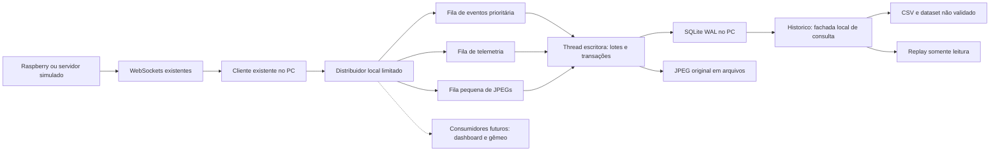
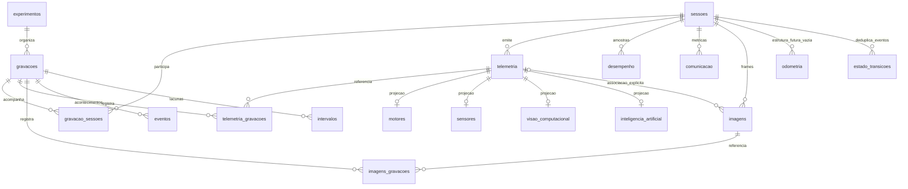

# Etapa 3 — SQLite, histórico operacional e reprodução no computador

Implementação de 25/11/2026 sobre `fd368c0` (Etapa 2). Desenvolvimento e testes
no Windows; nenhum acesso à Raspberry, serial, firmware ou câmera física.
Não há dashboard, Three.js, cálculo de odometria, treinamento ou processamento
externo de IA. Não houve push. Bancos, JPEGs, exportações e backups ficam locais.

## 1. Arquitetura e reutilização

O gravador usa uma instância do `Cliente` existente, com os mesmos endpoints e
protocolo v1. Não abre outra conexão de telemetria nem captura a ESP32. Se imagens
forem habilitadas, usa o canal binário que já existe na Etapa 2. Sem imagens
contínuas ou por evento, o receptor de armazenamento nem abre esse canal.
Usar `historico.py gravar` como receptor único, sem executar outro
`rede_cliente.py` apenas para alimentar o mesmo banco. Em integração Python,
anexar `Gravador` ao distribuidor do cliente já existente; não criar outro cliente.



`Distribuidor` faz fan-out de referências somente de leitura, com assinantes
independentes e filas limitadas. Não executa callbacks de disco/banco no event
loop. Consumidores não devem modificar os envelopes compartilhados. Há no
máximo 16 assinantes e capacidade máxima validada por fila.

Correções/aditamentos mínimos às etapas anteriores:

- `Cliente` aceita distribuidor opcional, preservando suas filas/API antigas;
  publica somente mensagens já validadas e a hora UTC de recepção no PC.
- Eventos locais de conexão/reconexão/desconexão são observáveis pelo mesmo
  distribuidor. Não são novos comandos nem mensagens de controle do carrinho.
- `receber_imagens=False` é opcional; comportamento padrão do cliente antigo
  continua recebendo os dois canais.
- `Telemetria` passa a exportar `frame_id`, já disponível no estado, para
  associação exata. `Amostras` exporta o instante monotônico da medição de SO
  para evitar repetir a mesma amostra de 1 Hz em todas as mensagens de 10 Hz.
- Não houve alteração de captura, interpretação de linha, PI/PD, Bluetooth,
  watchdogs, pinagem, firmware, configuração de rede ou painel de coleta.

## 2. Modelo relacional e conceitos de sessão

**Sessão operacional**: UUID do processo servidor da Etapa 2. Uma reconexão
temporária conserva esse UUID. Início/fim armazenados são os primeiros/últimos
instantes **observados**, não o instante físico de boot ou desligamento.

**Gravação**: UUID e janela independente no computador. Pode ser iniciada,
pausada, retomada, nomeada, anotada e encerrada. Uma gravação pode acompanhar
mais de uma sessão operacional, e uma sessão pode participar de várias gravações.
Modo de processamento fornecido na CLI é metadado **declarado pelo operador**;
não habilita nem comprova execução embarcada/distribuída. O modo operacional
PARADO/SEGUINDO/etc. é recebido na telemetria e armazenado separadamente.



Há 19 tabelas, incluindo `schema_migracoes` e associações. Cada projeção
motores/sensores/visão/IA usa a chave da telemetria como PK/FK, permitindo no
máximo uma linha por amostra. Uma categoria ausente não recebe uma linha
artificial cheia de zeros. O envelope completo de origem é preservado uma vez
em `telemetria.mensagem_json`, em JSON canônico (não os espaços originais da rede).
Metadados de recepção do PC são colunas separadas. O envelope de imagem fica
em sua tabela, sem bytes JPEG no SQLite.

Identidade única: `(sessao_id, canal, sequencia)`, respeitando canais diferentes.
Reenfileirar uma amostra já registrada cria apenas a associação à gravação,
sem duplicar telemetria ou arquivo. Não se associa imagem de uma sessão a outra.

O [dicionário de dados completo](21_dicionario_dados_historico.md) descreve
todas as colunas, tipos SQLite, unidades, nulabilidade e referências.

## 3. Integridade, migrações e concorrência

Esquema atual v2, em `PRAGMA user_version` e `schema_migracoes`:

1. Tabelas, chaves estrangeiras, CHECKs e unicidade.
2. Índices de tempo/sessão/frame/experimento e marca de recuperação da gravação.

Migrações cumulativas são transacionais e preservam registros. Uma versão mais
nova que o programa é recusada. Foreign keys são ativadas em cada conexão.
O teste v1→v2 conserva um experimento existente e verifica a versão final.

Um lock de sistema operacional (`writer.lock`) impede dois gravadores/gestores
de escrita no mesmo diretório. A existência do arquivo não é o lock: a morte
do processo libera o bloqueio. Consultas e backups usam conexões próprias de
leitura. `WAL`, `synchronous=FULL`, transações de lote e timeout de 250 ms
mantêm leituras independentes; bloqueio transitório de escrita tem até três
tentativas, com esperas limitadas no escritor, nunca no receptor.

Exportações longas podem reter um snapshot de leitura e aumentar o WAL. Para
um conjunto acadêmico congelado, encerrar a gravação ou exportar uma cópia de
backup. Não foi implementado SQL arbitrário pela fachada/CLI nem servidor HTTP.
Para coleta real, preferir `--raiz` em disco local e não tratar sincronização
automática de uma pasta ativa (por exemplo OneDrive) como backup consistente.
O HTTP existente pertence à Raspberry/painel de coleta; não foi reutilizado
para expor o banco do PC. Nesta etapa a interface é Python local + terminal,
com categorias/filtros permitidos e parâmetros SQL vinculados.

## 4. Qualidade e significado dos dados

- `NULL` significa indisponível; CSV usa célula vazia. Zero é mantido apenas
  quando realmente recebido/calculado como zero, ou em contadores conhecidos.
- Natureza e estado originais são preservados nos JSONs de qualidade e no
  envelope. Valores vencidos são arquivados com sua qualidade; não viram novos
  dados atuais. Estatísticas das projeções excluem campos explicitamente vencidos.
- `simulado` identifica o domínio operacional. Sistema/CPU também tem
  `dispositivo`, host/plataforma e `natureza`: recurso do Windows medido durante
  uma simulação continua **medido no host**, não temperatura da Raspberry.
- O gerador de carga desta etapa injeta CPU/RAM/temperatura artificiais e os
  marca `sistema_natureza=simulado`. Métricas do PC coletadas por `Sistema` são
  separadas como dispositivo `computador`, natureza `medido_no_host`.
- `pwm_informado_*` vem do F8, valor calculado informado pelo firmware, não
  tensão medida. PWM e referências assinados indicam sentido **comandado**.
  Encoders de um canal fornecem magnitude de pulsos, não sentido medido.
- Referências/PWM solicitados são o **último pedido observado**, não confirmação
  de alvo atualmente aplicado. Idade e estado desse pedido permanecem em
  `motores.qualidade_json.pedidos_observados`; uma parada não transforma um
  pedido antigo em referência ativa. Conferir também modo e PWM informado.
- Servo é `servo_comandado_graus`, sem feedback de posição física. Erro interno
  do PI, velocidade sem calibração, recompensa/modelo ausentes permanecem NULL.
- Timestamps são normalizados em UTC ISO-8601 com microssegundos. Timestamp
  fonte original é preservado no envelope. Eventos derivados usam recepção
  UTC do PC e guardam o timestamp fonte nos detalhes. Não se calcula latência
  de sentido único por diferença de relógios de dispositivos.
- Duração operacional observada usa diferença monotônica da **mesma sessão**;
  múltiplas sessões não têm seus relógios subtraídos. Horários locais serão
  responsabilidade da apresentação futura.
- Limiares administrativos de alerta CPU/temperatura são opcionais, `None`
  por padrão, configuráveis. Não foram apresentados como calibração física.

## 5. Eventos, pausas e recuperação de sessões

Eventos de controle da gravação, conexão, desconexão, reconexão, erros e
transições de modo/linha/câmera/sensor/encoder/obstáculo são registrados com
categoria, gravidade, origem, timestamp e detalhes. São **transições observadas**,
não diagnóstico causal do hardware. Não se inventa “parada de emergência” ou
“Arduino quebrado” quando a telemetria não fornece esse diagnóstico específico.

`estado_transicoes` conserva o último valor conhecido por sessão. Leituras
repetidas do mesmo obstáculo contam uma vez; ausência/valor vencido não rearma
a contagem. É necessária uma observação válida de liberação para novo evento
de detecção. Isso conta encontros observados, não identifica objetos físicos.

`intervalos` armazena pausas e desconexões por canal. Reconexão fecha o intervalo
da mesma sessão/canal; não cria dados para o vão. Encerrar uma gravação fecha
intervalos no limite da gravação, indicando `..._ate_encerramento`. Pausar
significa parar o armazenamento das amostras, não parar o carrinho ou a rede.
Mensagens da pausa são descartadas e não reaparecem após retomar.

Depois de morte inesperada, o novo escritor exclusivo marca gravações abertas
como `interrompida`. `fim_utc` permanece NULL porque o instante exato de morte é
desconhecido; `recuperada_utc` indica quando isso foi constatado. Ler o banco não
marca uma gravação ativa como interrompida. `historico.py recuperar` faz essa
recuperação sem abrir rede, quando não existe outro escritor.

## 6. Filas, falhas e limites

Padrões centrais: telemetria 2048, eventos 128, imagens 8, comandos locais 32,
lote 128, espera do escritor 200 ms. Eventos são drenados primeiro, depois
telemetria, depois imagens. Cada lote é uma transação; savepoints isolam amostras
inválidas. Não há transação por campo. Imagem inválida/limite de imagens não
descarta a telemetria já preparada no lote.

Política de congestionamento do armazenamento: **rejeitar o novo item** quando
a fila desse consumidor estiver cheia, preservando itens aceitos e contando a
rejeição. Isso difere do transporte latest-only da Etapa 2. Uma fila lenta não
consome itens de outro assinante. Eventos têm fila reservada, mas ela também é
limitada: saturação extrema pode perder eventos; não se promete retenção infinita.
Contadores e evento `descarte_armazenamento` registram a perda quando há escrita.

Contadores distinguem recebidas/consumidas, telemetrias persistidas, imagens
persistidas, eventos de rede, duplicadas, descarte por fila, fora da gravação,
antes do início/retomada, política de imagens, inválidas e falhas. `persistidas`
no snapshot refere-se a **telemetrias únicas**, não ao número de linhas SQL
das projeções. Totais do processo e diferenças da gravação são separados.

Falha de escrita/disco cheio faz rollback, reverte somente JPEGs novos daquela
transação, marca falha em memória e preserva o transporte. Dados que não foram
gravados são contados, não guardados em fila ilimitada. Após corrigir a causa,
retomada manual registra a recuperação e não finge recuperar amostras perdidas.
Uma falha persistente pode impedir gravar o próprio evento de falha no disco;
o log/snapshot continuam informando e o próximo início detecta interrupção.

Quota administrativa padrão de gravação: **2 GiB DB+WAL+imagens**, dos quais
até **500 MiB em imagens**, mais reserva livre de **100 MiB** no volume. Limites
não são parâmetros físicos e podem ser ajustados. Verificação por lote permite
ultrapassagem limitada ao lote em andamento; não é quota rígida do sistema de
arquivos. Backups/exportações são ações explícitas adicionais e exigem espaço.
Não há exclusão automática de sessões/imagens antigas.

## 7. Imagens e consistência

```text
dados_historico/
  banco/robo_seguidor.db
  imagens/<sessao_operacional>/<sequencia>_<sha256>.jpg
  exportacoes/<uuid>/
  backups/<uuid>/
```

Gravação contínua e imagens por eventos começam **desabilitadas**. `--imagens`
habilita a contínua e `--imagens-fps` limita o armazenamento, inicialmente 1 FPS.
`--imagens-eventos` permite registrar um JPEG recente associado a transição,
sem habilitar a contínua. O cache tem um JPEG, não um histórico ilimitado.

JPEG original é validado, recebe SHA-256, é escrito em temporário próprio,
sincronizado e publicado por rename. Dimensões são verificadas antes de
decodificar: limite administrativo de 4 MiB compactados e 1920×1080 pixels
totais (nenhum eixo acima de 4096), não uma mudança da resolução da ESP32.
A gravação usa o OpenCV já presente nas dependências do PC; não reencoda o JPEG.

Arquivo e SQLite não formam uma transação atômica única: se houver crash entre
rename e commit, pode sobrar arquivo órfão. Auditoria identifica órfãos, `.part`,
ausências e divergências de hash, **sem apagá-los automaticamente**. Rollback
normal remove apenas arquivos novos não confirmados daquela transação. Arquivos
preexistentes não são sobrescritos. Hash de banco/imagens é calculado em blocos
para não carregar bancos grandes inteiros na RAM.

Associação: primeiro `frame_id` exato na mesma sessão; caso não exista, vizinho
temporal na mesma base monotônica do servidor dentro da tolerância configurada
(250 ms por padrão), marcado `temporal_estimado`. Pode ficar `nenhuma`. Associações
pendentes recentes também são tentadas após telemetria nova. Isso não cria rótulos
de treino. `dataset.csv` usa uma linha por imagem e `estado_rotulo_treino=nao_validado`.

## 8. Consultas, estatísticas e exportação

`Historico` oferece `consultar`, `iterar`, `estatistica`, `resumo`, `estado` e
`integridade`. Filtros: sessão, gravação, experimento, período UTC, modo declarado,
real/simulado e, quando aplicável, dispositivo/lado. Paginação validada (até
1000 linhas por página), índices e cursor `fetchmany` para exports/replay.
Categorias e colunas estatísticas são permitidas explicitamente; valores são
passados como parâmetros, não concatenados em SQL.

Estatísticas: n, média, mínimo, máximo, mediana, desvio padrão populacional e p95
com interpolação. São calculadas sobre valores não NULL; o desvio usa Welford,
e percentis usam ordenação SQL. Sem filtro de domínio, resultados são separados
em `real`/`simulado`. Para recursos, selecionar também `--dispositivo servidor`
ou `computador`; para RTT, selecionar `--lado`. Um valor agregado de vários
dispositivos não caracteriza individualmente nenhum deles.

Resumo traz duração observada, eventos, encontros com obstáculos e frequência
de falhas observadas. Taxa de descarte é de gravações fechadas completas e de
um único domínio; não atribui contadores mistos a um domínio nem os projeta
para um recorte de tempo parcial. Inclui descartes intencionais, não perda física
de pacotes de rede. As causas devem ser analisadas pelos contadores separados.

CSV UTF-8 com BOM, NULL vazio, cabeçalhos/unidades no dicionário. Texto iniciado
por caracteres de fórmula recebe apóstrofo de proteção para Excel; valores
numéricos não são alterados. JSON fonte no banco permanece intacto. Categorias
vazias, incluindo odometria, mantêm cabeçalhos reais e zero registros.

`consolidado` usa apenas joins 1:1 das projeções e subconsultas de desempenho/
comunicação, sem multiplicar amostras por número de imagens. `dataset` é separado,
uma linha por imagem, com qualidade e associação explícitas. Predição da CNN e
comando de motor nunca viram rótulo humano validado automaticamente.

## 9. Reprodução histórica e interface para a Etapa 4

`Reprodutor` lê telemetria, imagens, eventos e intervalos ordenados em UTC
observado no PC, com desempate determinístico. Oferece `iniciar`, `pausar`,
`retomar`, `reiniciar`, `buscar`, `velocidade` (0,1 a 100×) e `parar`.
O relógio de reprodução usa monotônico local; lacunas não são preenchidas por
interpolação. Alteração brusca do relógio UTC durante gravação é uma limitação
do ordenamento histórico e exige análise do experimento.

Saída tem `origem=reproducao_historica`, `somente_leitura=True` e
`envelope_original`, preservando domínio/origem original. JPEG ausente ou hash
divergente é sinalizado. Replay não importa cliente de rede, controle ou serial
e não reenvia mensagens ao carrinho. O futuro gêmeo poderá adaptar o envelope
para apresentação, com animações explicitamente medidas/estimadas/comandadas.
Nenhuma pose/rotação física foi calculada; `odometria` está vazia.

## 10. Comandos Windows

Executar na pasta do projeto, com o Python do ambiente usado nas etapas anteriores:

```powershell
python -m pip install -r requirements-armazenamento-pc.txt
python tools/historico.py inicializar
```

Não foi adicionada dependência de banco via pip: SQLite, CSV, threading, filas,
hashes e backup são da biblioteca padrão. SQLite deve incluir funções JSON,
presentes no ambiente CPython 3.13 testado. Arquivos de dependências da Pi não
foram alterados. O gravador não é iniciado pela main; a CLI recusa execução
quando identifica modelo Raspberry Pi no sistema.

Servidor simulado da Etapa 2, terminal 1:

```powershell
$env:ROBO_REDE_TOKEN = Read-Host 'Token forte, igual nos dois terminais'
python tools/rede_servidor_simulado.py
```

Receptor/gravador, terminal 2:

```powershell
$env:ROBO_REDE_TOKEN = Read-Host 'Cole o mesmo token'
python tools/historico.py gravar --servidor ws://127.0.0.1:8765
```

Por padrão a gravação é manual. No prompt: `iniciar Nome`, `pausar`, `retomar`,
`encerrar`, `status`, `sair`. Isso controla somente arquivos do PC.

```powershell
# Automática por 20 s; imagens permanecem desligadas:
python tools/historico.py gravar --servidor ws://127.0.0.1:8765 --automatico --duracao 20 --nome "Teste local" --modo simulacao
# Com JPEGs a 1 FPS:
python tools/historico.py gravar --servidor ws://127.0.0.1:8765 --automatico --duracao 20 --imagens --imagens-fps 1
# Inicializador equivalente:
.\tools\historico_pc.ps1 -Servidor ws://127.0.0.1:8765 -Automatico
```

Consultar e exportar (substituir `UUID` pelo identificador retornado):

```powershell
python tools/historico.py consultar gravacoes
python tools/historico.py consultar sessoes --dominio simulado
python tools/historico.py consultar motores --sessao UUID --limite 50 --pagina 0
python tools/historico.py estatisticas desempenho cpu_pct --dispositivo servidor --dominio simulado
python tools/historico.py resumo --sessao UUID --dominio simulado
python tools/historico.py exportar --sessao UUID --categorias "consolidado,motores,sensores,eventos,imagens,dataset,odometria"
python tools/historico.py integridade
python tools/historico.py reproduzir --sessao UUID --velocidade 10 --limite 100
```

Para outro diretório: `python tools/historico.py --raiz CAMINHO consultar sessoes`.
`--raiz` vem antes da ação. Categorias e filtros completos em `--help`.

```powershell
python tools/historico.py experimento --nome "Comparacao futura" --objetivo "Medir custo" --repeticao 1
python tools/historico.py anotar --gravacao UUID --nome "Nome revisado" --observacoes "Condicoes observadas"
```

Gestão offline exige lock exclusivo; durante gravação, usar métodos do objeto
`Gravador` (por exemplo `comandar('experimento', ...)`). Consultas/backup podem
executar enquanto o escritor está ativo. Não há comando de exclusão automática.

## 11. Backup e restauração

```powershell
python tools/historico.py backup
python tools/historico.py backup --sem-imagens
python tools/historico.py restaurar --backup CAMINHO_BACKUP --destino DIRETORIO_NOVO --confirmar
python tools/historico.py --raiz DIRETORIO_NOVO integridade
python tools/historico.py recuperar
```

Usa a API online `Connection.backup`, com páginas e verificação de integridade;
não copia um DB ativo ignorando o WAL. O snapshot determina quais imagens
imutáveis copiar. Manifesto registra hash do banco, imagens ausentes/divergentes
e se imagens foram incluídas. Backup sem imagens permite recuperar metadados,
mas não promete recuperar JPEGs que não foram copiados.

Restauração exige confirmação e **diretório inexistente**. Nunca sobrescreve um
banco existente, nem mesmo com `--confirmar`. Valida hashes e integridade; depois
apontar a CLI ao novo diretório. Gravação aberta no snapshot é recuperada como
interrompida ao iniciar escritor nesse banco. Se uma restauração falhar, a pasta
parcial permanece para inspeção; não é apagada automaticamente.

## 12. Exemplos SQL somente de leitura

Estes exemplos são para análise local autorizada, não endpoints SQL da aplicação:

```sql
-- Últimas sessões, com domínio explícito.
SELECT id,origem,simulado,inicio_observado_utc,fim_observado_utc FROM sessoes
ORDER BY inicio_observado_utc DESC LIMIT 20;

-- Velocidade em magnitude; consultar qualidade para descartar dados vencidos.
SELECT t.recebido_utc,t.simulado,m.pps_esq,m.pps_dir,m.qualidade_json
FROM telemetria t JOIN motores m ON m.telemetria_id=t.id
WHERE t.sessao_id=:sessao ORDER BY t.recebido_utc;

-- Encontros observados, sem contar cada leitura consecutiva.
SELECT sessao_id,COUNT(*) FROM eventos WHERE categoria='obstaculo_detectado'
GROUP BY sessao_id;

-- Recursos separados por dispositivo e natureza.
SELECT dispositivo,natureza,simulado,AVG(cpu_pct),MAX(temperatura_c)
FROM desempenho GROUP BY dispositivo,natureza,simulado;

-- Arquivos sem vínculo temporal exato permanecem explicitamente identificados.
SELECT caminho,frame_id,associacao_tipo,desvio_temporal_s,telemetria_id FROM imagens;
```

## 13. Arquivos da entrega

Novos: `armazenamento/` (banco, migrações, configuração, normalização, eventos,
gravador, imagens, consultas, exportação, backup, gestão, receptor e reprodução),
`comunicacao/distribuidor.py`, `tools/historico.py`, `tools/historico_pc.ps1`,
`tools/testar_historico_carga.py`, `tests/test_armazenamento.py`,
`requirements-armazenamento-pc.txt`, este guia e dicionário.

Modificados: `comunicacao/cliente.py`, `comunicacao/amostras.py`,
`monitoramento/telemetria.py` (somente integração/metadados descritos acima),
`config.py`, `.gitignore`, README e contexto. O modelo GLB/Blender original
permanece preservado fora do repositório, sem cópia ou alterações.

## 14. Verificação e resultados

Comandos:

```powershell
python -m unittest discover -s tests -p test_armazenamento.py -v
python tools/testar_historico_carga.py --duracao 4
```

28 testes novos: criação/WAL/FKs, migração, lote/deduplicação/NULL, desempenho
sem repetição, sessões/pausa, eventos de obstáculo, imagens desligadas e por
evento, associação exata/estimada, quotas e corrupção, consultas/filtros/estatísticas,
CSV consolidado, backup/restauração com JPEG, hash divergente, replay/pausa/reinício,
fila/fan-out, escrita/disco cheio simulados, retry, lock de escritor e recuperação.
O teste integrado usa WebSockets localhost reais e confirma somente um cliente
com seus canais, reconexão com mesma sessão e nenhum acesso a serial física.

Um subprocesso encerrado via `os._exit` valida recuperação de gravação. Outro
interrompe entre arquivo JPEG e commit: SQLite íntegro, imagem não confirmada
identificada como órfã e mantida para inspeção. Não são quedas de energia físicas.
Resultados da regressão e carga, exemplo de sessão, CSVs e estimativas estão
no registro de resultados abaixo; nenhum número representa a Raspberry.

### Resultados efetivamente obtidos

Regressão compatível final: **397 passed, 1 skipped, 4 deselected,
56 subtests passed**, incluindo os 28 testes novos. Mesmas exclusões das Etapas
1/2: arquivos de integração PTY e Wi-Fi Linux; casos de ciclo sintético e Mock
de sinalização já falhando antes; caso BlueZ dependente de biblioteca ausente;
caso serial PTY indisponível no Windows. Não é toda a suíte sem exclusões.

CLI em processos separados: servidor simulado + `historico.py gravar`, 2,5 s,
ambos sem erro; **22 telemetrias, zero imagens por padrão**, SQLite `ok`.
Diretório local: `dados_historico/validacao_cli_3c47872401c141a79e4b487ea402ce17`.

Carga final: `dados_historico/validacao_20261125T180054180450Z/resultado.json`,
três cenários de quatro segundos com gravação JPEG explicitamente em 2 FPS:

| Alvo telemetria / imagem de rede | Condição | Telemetrias persistidas | JPEGs | DB final | Média por lote | p95 por lote | Consulta resumo | Exportação |
|---|---|---:|---:|---:|---:|---:|---:|---:|
| 10 Hz / 5 FPS | Normal | 35 | 6 | 608 KiB | 32,90 ms | 50,90 ms | 12,95 ms | 90,77 ms |
| 50 Hz / 15 FPS | Carga maior | 133 | 8 | 1744 KiB | 64,27 ms | 85,35 ms | 11,97 ms | 161,36 ms |
| 100 Hz / 30 FPS | Atraso, descarte e desconexão injetados | 40 | 7 | 736 KiB | 48,45 ms | 68,58 ms | 7,07 ms | 100,38 ms |

Em todos: zero falhas de armazenamento, zero descartes por saturação das filas
do gravador, integridade `ok`, sem FK inválida/imagem ausente/hash divergente.
Os descartes do gravador foram **12/44/33 JPEGs por política de frequência**,
não perdas de telemetria do SQLite. O cenário 100 Hz inclui perdas/filas no
transporte injetadas de propósito; não significa que 100 Hz foi sustentado.
Eventos registraram um encontro com obstáculo por cenário, sem contar cada
leitura repetida. Duas notificações de desconexão representam os dois canais,
não dois incidentes físicos independentes. Frequência extrapolada de falhas em
ensaio tão curto é apenas uma razão matemática, não índice de confiabilidade.

Tempos de lote incluem normalização, eventos, SQL e eventuais arquivos/JPEGs;
não são tempos por campo ou por quadro. Sistema Windows, Python 3.13.2,
localhost; não medir a Raspberry a partir desses valores.

### Sessão e CSVs de exemplo

Exemplo normal, já armazenado localmente:

- Raiz: `dados_historico/validacao_20261125T180054180450Z/cenario_10hz`.
- Sessão operacional: `ba962eab-2ece-4dbe-8e22-3aba24305e02`.
- Gravação PC: `e1a7a2f1-a627-4ddd-84b9-a316d40229e3`.
- Domínio: simulado; 35 telemetrias únicas e seis JPEGs; origem `simulador`.
- Observação: `2026-11-25T18:00:54.529571+00:00` a
  `2026-11-25T18:00:58.365064+00:00`, não instantes físicos de ligar/desligar.
- CSVs: subpasta `exportacoes/18008ef9-ee01-41ec-b481-8408f7798cc6/`.
- Backup: subpasta `backups/654cb6a0-03c0-40f3-832f-f0f5aaab29d5/`.

Foram exportadas todas as projeções, envelope fonte, eventos, desempenho,
comunicação, sessões, imagens/dataset e odometria vazia. Consolidado tem 35
linhas; dataset tem seis linhas, sem multiplicar telemetrias por imagem.
Os arquivos locais são ignorados no Git; o relatório/dicionário são versionados.

```powershell
python tools/historico.py --raiz dados_historico/validacao_20261125T180054180450Z/cenario_10hz consultar sessoes
python tools/historico.py --raiz dados_historico/validacao_20261125T180054180450Z/cenario_10hz consultar imagens
```

### Estimativas de crescimento, com limites de interpretação

Esquema vazio: 176128 bytes. No cenário 10 Hz, DB final 622592 bytes: aumento
de 446464 bytes em quatro segundos, extrapolação linear de **401,8 MB/h**.
No cenário 50 Hz, extrapolação de **1448,8 MB/h**. Não são limites de capacidade
nem projeções confiáveis de produção: ensaio curto, páginas/índices, envelopes,
WAL, versões de payload e padrões de qualidade mudam o custo. Auditoria em JSON
mais projeções normalizadas tem custo de espaço explícito. SO é deduplicado por
instante, mas o envelope fonte continua contendo seu snapshot original.

JPEG médio normal: **26356,8 bytes**. Fórmula:
`bytes_por_hora = tamanho_medio_JPEG × FPS_armazenado × 3600`.
Nesse conjunto sintético: cerca de **94,9 MB/h a 1 FPS**, **189,8 MB/h a 2 FPS**.
Gravação de imagens desativada → zero JPEGs novos. Fotos reais podem comprimir
muito diferente. Repetir ensaios longos e medir tamanho real antes de definir
retenção/capacidade; nenhuma exclusão automática foi implementada.

## 15. Limitações e validação futura

WAL e lotes reduzem contenção, mas não asseguram zero perda: quotas, disco cheio,
filas saturadas e falha do PC podem perder amostras, com indicação explícita.
Arquivo e banco têm recuperação auditável, não commit atômico entre sistemas.
Estatísticas não detectam automaticamente viés por dados descartados ou cenários
distintos. Imitação por comando não é rótulo validado de trajetória/ação ótima.

Hardware pendente: conferir valores/flags reais, versão e semântica dos pesos,
sincronismo de frames, reconexões Wi-Fi, alimentação, perdas e espaço sob carga
real. Posteriormente observar câmera compartilhada e autonomia local enquanto
o PC grava/desconecta. Nenhuma falha de armazenamento pode comandar o carrinho.

Etapa 4 preparada: fachada de consulta, fan-out e replay em modo somente leitura;
tratar eixos/calibração reais antes de converter pulsos em animação/odometria.
Não criar modelo genérico ou inventar parâmetros físicos. Three.js/dashboard
e integração dos arquivos originais continuarão sendo uma etapa separada.
