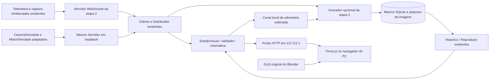

# Etapa 4 — Gêmeo digital 3D

Implementado no computador em 25/11/2026. Simulação e histórico não precisam
da Raspberry ou Arduino. Integração física e calibração no piso continuam
pendentes. O visualizador não oferece comandos de atuação.

## Arquitetura e integração com as etapas 1–3



Há um único cliente central por fonte, não uma conexão por componente. A
simulação atravessa o contrato e o transporte existentes. O frontend consulta
a ponte a 10 Hz e o JPEG a até 5 Hz; a renderização usa requestAnimationFrame.
Não há captura paralela da ESP32-CAM, conexão serial ou renderização na Pi.

Foram escolhidos JavaScript com módulos nativos, importmap e HTTP Python.
Vite/React não eram necessários. Three.js 0.187.0 é a única nova dependência JS
de execução, fixada no package-lock. O Python reutiliza as dependências do PC.

## Arquivos e responsabilidades

| Arquivo/módulo | Responsabilidade |
|---|---|
| gemeo_digital/analise_modelo.py | GLB, hash, nomes, hierarquia, materiais e PCA |
| modelos/diagnostico.json | Análise completa verificável do GLB |
| modelos/carrinho_configurado_eixos.json | Metadados originais do Blender |
| cinematica.py | Calibração e odometria diferencial em SI |
| estado_visual.py | Validação, sequência, validade, fases e restauração de pose |
| simulacao.py | Cenário ajustável sobre simuladores existentes |
| integracao.py | Fontes, cliente, fanout, gravação opcional e replay |
| servidor.py | HTTP restrito a loopback e API local |
| frontend/src/cena.js | Cena, iluminação, sombras, câmera e trajetórias |
| frontend/src/modelo.js | Carregamento, identificação, seleção e transforms |
| frontend/src/animacao.js | Quaternions, coordenadas e extrapolação limitada |
| frontend/src/sensores.js | FOV, sonar, obstáculo e indicadores ópticos |
| frontend/src/dados.js | Consumo da ponte centralizada |
| frontend/src/interface.js | Funções e métricas dos componentes |
| frontend/src/main.js | Composição e controles de simulação/histórico |
| frontend/src/verificacao.js | Verificações sobre o GLB realmente carregado |
| frontend/index.html e style.css | Interface em português e layout responsivo |
| gemeo_digital/testes/animacao.test.js | Testes Node das animações e do relógio |
| tests/test_gemeo_digital.py | Cinemática, validação e integração HTTP/WS/SQLite |
| tools/gemeo_digital.py e iniciar_gemeo.ps1 | Inicialização no PC/Windows |
| requirements-gemeo-pc.txt | Reuso das dependências Python do PC |

Mudanças pontuais nas etapas anteriores:

- `armazenamento/gravador.py` recebe o canal local de odometria e usa a tabela,
  escritor e transação já existentes.
- `armazenamento/reproducao.py` expõe registros e posição temporal, preserva
  uma busca anterior ao início do iterador e inclui a odometria armazenada.
  Com timestamps iguais, aplica a pose persistida depois da telemetria.
- `monitoramento/telemetria.py` calcula a idade após os getters de sensores,
  evitando idades ligeiramente negativas quando o simulador produz uma amostra
  durante a chamada. Não altera comandos ou controle.
- `.gitignore`, README e contexto documentam e isolam os recursos locais.

Firmware, pinagem, controladores, rede da câmera, CNN e serviços embarcados
não foram alterados. A quinta etapa não foi implementada.

## Modelo, componentes e hierarquia

Original: 313 nós, 312 meshes e 37 materiais. O GLTFLoader gera objetos adicionais
para meshes com múltiplos materiais: 363 objetos Three.js observados, sem alterar
o arquivo. O GLB local é cópia idêntica, de 3.583.476 bytes, ao original em
`C:\Users\kaueb\OneDrive\Documentos\modelo_carrinho`. Hash e instalação constam
no [README do gêmeo](../gemeo_digital/README.md). GLB e node_modules ficam fora do Git.

Os 23 componentes foram identificados por nome. Duas equivalências necessárias:

| Nome funcional | Nome real no GLB |
|---|---|
| chassi_inferior | acrilico_0.035_674 |
| chassi_superior | acrilico_0.105_673 |

Os demais existem com os nomes solicitados: carrinho_raiz; rodas esquerda,
direita e de apoio; motores esquerdo/direito; encoders esquerdo/direito;
disco_encoder_esquerdo/direito; servo_base; servo_eixo; sensor_ultrassonico;
esp32_cam; raspberry_pi; arduino_uno; ponte_h; regulador_tensao;
placa_universal; case_baterias_1/2. O carregador sanitiza pontos nos nomes;
por isso também consultamos o nome original em userData.name, sem índices fixos.

```text
carrinho_raiz
├── chassis, rodas, motores e discos
├── sensores ópticos dos encoders (fixos)
├── servo_base (fixa)
├── servo_eixo (móvel)
│   └── sensor_ultrassonico
└── câmera, eletrônica, baterias e conexões
```

A hierarquia completa está no diagnóstico versionado. Materiais, transparência,
geometria, escala e transforms originais são preservados. O destaque usa uma
caixa auxiliar; caixas de seleção/foco ignoram os helpers. A vista explodida
é exclusivamente visual e restaura exatamente as posições ao ser desativada.

## Eixos e animações

O JSON usa Z vertical no Blender; no GLB exportado, Y é vertical, X é transversal
e −Z aponta à frente. Não se aplicou o Z local do JSON diretamente ao Three.js.

Rodas/discos têm quaternion inicial próximo de (0,5; 0,5; −0,5; 0,5).
A PCA dos vértices identificou os eixos locais de menor espessura:

| Peça | Eixo local glTF |
|---|---|
| Roda esquerda | (−0,04163; 0,99752; 0,05671) |
| Roda direita | (0,00040; 1,00000; −0,00033) |
| Discos esquerdo/direito | Aproximadamente +Y |
| Eixo do servo | +Y |

A pequena inclinação da roda esquerda está na geometria exportada e não foi
corrigida deformando o original. Houve análise geométrica e inspeção no navegador;
isso não valida a montagem mecânica do protótipo físico.

Para cada roda, ω = 2π × PPS/PPR. A magnitude vem dos pulsos e o sentido do PWM
informado, pois os encoders atuais não medem o sentido. Deltas válidos de ticks
definem a fase base. O frontend suaviza a transição e extrapola somente dentro
da validade. Após vencimento, congela o último estado visual.

Aplica-se q_original × q(eixo_local, −fase), com fases independentes por lado;
o sinal corresponde ao avanço em −Z. Discos usam a relação configurada e, sem
ela, não simulam uma transmissão conhecida. Sensores ópticos permanecem fixos.

O servo gira relativamente ao centro, com limites, inversão e offset visuais.
O ultrassônico acompanha o pai servo_eixo; servo_base fica fixa. Mantivemos o
pivô original. O ângulo é comandado, não uma medição de posição física.

FOV e sonar são helpers alinhados ao −Y local dos respectivos objetos, que
corresponde à frente após as transforms. O FOV é estimado (60° verticais, 4:3),
e o sonar é ilustrativo (15°), sem calibração óptica/acústica. Os limiares de
parada/atenção vêm de config.py. Cinza indica dado vencido; lilás, leitura ausente;
verde, livre; amarelo, atenção; vermelho, obstáculo. A caixa só é virtual.

## Odometria, persistência e relógios

Por roda: Δs = Δticks × π × diâmetro/PPR × sentido_comandado.
O deslocamento central é (Δs_D + Δs_E)/2 e a variação angular é
(Δs_D − Δs_E)/bitola. A integração usa arco diferencial exato, com caso retilíneo
próximo de zero. Velocidades dividem os deslocamentos por Δt. Unidades: m, s, rad.

Odometria usa X à frente e Y à esquerda. Em Three.js, (X,Y) vira
(−Y, altura_original, −X), com yaw positivo em +Y. Move-se carrinho_raiz.
A trajetória é relativa, sujeita a deslizamento e erro acumulado, sem GPS.

Não há integração sem calibração, após regressão de ticks, mudança de sentido
sem intervalo confiável, Δt inválido, lacuna superior a 0,5 s ou dados vencidos.
Os monotônicos só fornecem deltas dentro da mesma fonte. A idade visual usa o
recebimento no PC e o limite superior de idade do protocolo. No histórico, usa
o relógio virtual e os timestamps de recebimento gravados no mesmo PC.

A busca reconstrói o prefixo da sessão com leitura paginada e memória limitada.
Gerações (`epoch`) descartam dados de fontes anteriores. A pose armazenada
prevalece sobre a recomputação, incluindo calibração e resets de referência.
O fim da reprodução pausa no último registro. Imagens fora da janela de 0,5 s
são ocultadas. Dados ausentes, inclusive coordenadas de linha, não são inventados.

Limites de memória: trajetória com 2.000 pontos; eventos com 40; métricas de
renderização com 600 amostras; erros com 20. JPEG mantém o mais recente e revoga
ObjectURLs anteriores. O GLB e as geometrias de trajetória não são reconstruídos
por mensagem. O modo econômico desativa sombras e reduz a densidade de pixels.

## Execução, modos e segurança

Veja [os comandos Windows e a operação](../gemeo_digital/README.md).
`iniciar_gemeo.ps1` inicia os serviços locais e abre o navegador. Simulação tem
controles de rodas, servo, distância, linha, câmera, motores, CPU, temperatura,
latência e interrupção da telemetria. Histórico oferece sessão, pausa, busca,
reinício, ±1 segundo, velocidade e comparação de trajetórias.

Tempo real requer URL e token existentes no terminal; permanece desabilitado
sem configuração. Há observação por uma conexão central, sem endpoint de
movimento. O token da Raspberry não vai ao navegador. HTTP restringe loopback,
Host, Origin e token de requisição. Não aceita SQL arbitrário.

O obstáculo virtual usa interseção simplificada de raio com círculo de 6 cm,
ativada separadamente da distância manual. Não modela ecos ou um ambiente 3D
medido. O FOV não é a ROI. Corrente, tensão, PWM físico aplicado e coordenadas
de linha não são apresentados como medidos quando o contrato não os fornece.

## Calibrações e validações físicas pendentes

1. PPR efetivo de cada roda, diâmetros no piso e bitola medida. As referências
   existentes de 19,4/19,2 PPR e 65 mm são de bancada, sem validação no piso.
2. Relação mecânica entre discos e rodas; montagem e sentidos físicos.
3. Centro, limites, inversão, pivô e alinhamento do servo/ultrassônico.
4. Intrínsecos da câmera, FOV e alinhamento extrínseco no carrinho.
5. Comunicação física e reconexão com a Raspberry no arranjo final.
6. Deslizamento e erro acumulado da odometria em ensaios no piso.

20/20 PPR, diâmetros 0,065 m, bitola 0,18 m e relação 1 são parâmetros
**somente sintéticos**. Não foram ativados como calibração real. O README
explica o JSON de calibração confirmada aceito pela execução futura.

## Testes e evidências

12 testes Python desta etapa e 5 testes Node. A regressão ampla selecionada
terminou com **409 aprovados, 1 ignorado, 4 desmarcados e 56 subtestes aprovados**
em 63,75 s. As exclusões são as de plataforma/integração previamente documentadas;
isso não representa testes físicos nem a suíte irrestrita:

```powershell
python -m pytest tests -q --ignore=tests/test_integracao_robo.py --ignore=tests/test_esp32_wifi.py -k 'not test_ciclo_completo_sintetico and not test_sem_bluez_o_servidor_nao_derruba_nada and not test_cadeia_completa_com_simulador and not test_partida_e_cancelamento' --disable-warnings
npm.cmd test --prefix gemeo_digital/frontend
```

Verifica GLB/hash/hierarquia; materiais e transforms; seleção por Raycaster;
rodas independentes; discos e sensores fixos; servo e filho; frustums; coordenadas;
reta, ré, curva e giro; mensagens inválidas; sequência; sessões; expiração;
trajetória limitada; HTTP/WS/SQLite em loopback; isolamento; gravação de odometria;
replay, pausa, busca repetida sem acumular fases; restauração de calibração/referência.

O navegador também executa verificações no modelo carregado, acessíveis em
`/api/diagnostico`. Capturas e métricas ficam em `dados_gemeo/validacao/`, fora do
Git; os resultados medidos finais constam em resultado_validacao.json. O tempo
de renderização medido é CPU/submit do Three.js, não tempo de GPU completo,
latência física de controle ou frequência de sensores.

Na execução final, as 13 verificações do navegador passaram e o console
consultado não apresentou erros ou avisos. Inspeção por automação do navegador
(locators Playwright): seleção, rodas/servo, vistas, chassi oculto, vista explodida,
FOV, falha de telemetria, pausa e busca de histórico. Layouts desktop e estreito
foram inspecionados; o enquadramento foi adaptado à proporção da área 3D.

Medição observada no navegador Chromium 158/Windows, janela 1440×960, área 3D
926×673, pixel ratio 1, qualidade equilibrada, FOV e sonar ativos, 600 amostras:

| Métrica | Resultado observado |
|---|---|
| FPS de renderização | 60 |
| Carregamento local do modelo e inicialização | 115 ms |
| Tempo médio CPU/submit de renderização | 7,79 ms |
| Mediana / p95 CPU/submit | 7,40 / 12,90 ms |
| Chamadas de desenho / triângulos | 702 / 143.606 |
| Geometrias / texturas | 355 / 3 |
| Heap JavaScript informado pelo navegador | 52.498.676 bytes |

São observações desta máquina e desta execução; não metas garantidas nem uma
medição de vazamento ou consumo total da GPU. Dependências efetivamente usadas:
Python 3.13, Three.js 0.187.0, websockets 14.2, NumPy 2.2.3, OpenCV 4.12.0 e
psutil 7.2.2. Node.js 24.16 executou os testes JS.

## Continuidade

Ponte, EstadoVisual, Modelo, Cena, Sensores e os endpoints locais podem ser
compostos pelo dashboard futuro. As fontes já compartilham uma interface.
Não se ativaram processamento distribuído de IA, deploy embarcado, treino,
atuação remota ou a quinta etapa.
