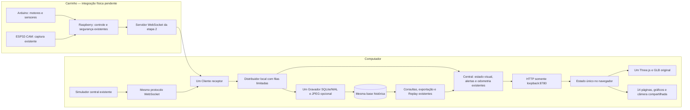

# Etapa 5 — Central de monitoramento no computador

Entrega de 25/11/2026. Plataforma funcional em Windows com dados simulados e
históricos. Reutiliza as etapas 1–4. A verificação física permanece posterior;
esta entrega não comprova autonomia, calibração no piso ou parada remota real.

## Arquitetura e integração



`Central` estende `Ponte`; `HandlerCentral` estende o servidor HTTP existente.
O modo selecionado tem apenas um fluxo receptor ativo. A navegação muda o conteúdo
e desloca o mesmo DOM/canvas do gêmeo e da câmera: não usa iframes, novos renderers,
captura paralela ou WebSocket por gráfico. O distribuidor e o escritor da central
duram por toda a aplicação; troca de fonte encerra a gravação e não a retoma.

O navegador reutiliza `Dados` da etapa 4 e recebe um evento local `robo:estado`.
A identidade contém instância do servidor, geração e sessão; impede misturar
buffers e JPEGs após reinício ou troca de origem. O reinício também renova a
credencial HTTP local. O GLB continua carregado uma vez; renderização suspensa
quando seu contêiner está oculto. Não foi implementado carregamento inicial
inteiramente adiado do Three.js.

O modelo `carrinho_configurado.glb` foi preservado, SHA-256
`e2713914a205bfa6504aae3830a67766ad5f1592c5a825660b1677184571a52b`.
Seleção, hierarquia, materiais, rotação por quaternion, sonar/FOV, controles de
câmera, qualidade e odometria são os da etapa 4. O campo visual é ilustrativo.

## Navegação e funcionalidades

Todas as páginas mantêm origem, sessão, conexão, modo informado, RTT, gravação,
atualização e condições de atenção visíveis. O menu é recolhível, com navegação
adaptada a tela estreita. Temas escuro e claro são locais.

| Página | Disponível nesta entrega |
|---|---|
| Visão geral | Gêmeo original, câmera compartilhada, métricas rápidas, eventos e estado operacional |
| Gêmeo digital | Visualizador completo da etapa 4; seleção de componentes, perspectivas, visibilidade, trajetória, qualidade e tela cheia |
| Motores e encoders | Rodas separadas, PWM informado, ticks/PPS, sentido, estimativa calibrada, gráficos comparativos, diferença e derivada de PPS |
| Sensores | Distância/validade/idade, servo comandado, limites existentes, gráfico e representação polar com pontos antigos identificados |
| Visão computacional | JPEG original, cinza opcional no PC, erro/linha/confiança heurística, métricas disponíveis e atalho configurável para coleta |
| Inteligência artificial | Política informada, contrato/diagnósticos, métricas e curvas dos treinos próprios existentes; distribuição real indisponível |
| Desempenho | PC observado separado do host da telemetria; gráficos, memória/FPS/tempos do gêmeo, gravador e consultas |
| Comunicação | Topologia, estados conhecidos/desconhecidos, RTT/jitter, taxa média, contadores, gráficos, reconexão e destino configurável no PC |
| Odometria e trajetória | Estimativa 2D, zoom, referência virtual, comparação de sessão, exportação CSV/SVG; sem mapa fictício |
| Histórico de sessões | Busca/filtros/paginação, resumo estatístico, nome/observações, imagens, reprodução e exportação |
| Experimentos | Objetivo/hipótese/configurações/condições/repetições, associação de sessões, comparação de até seis, tabela, barras, boxplot e histograma |
| Simulação | Sete cenários, parâmetros existentes, direções/velocidade, falhas, pausa/retomada/reinício/encerramento e emergência simulada |
| Diagnóstico e eventos | Falhas ativas/resolvidas, transições sem repetição contínua, filtros, paginação e detalhes técnicos |
| Configurações | Tema, unidades, frequências/janela, qualidade, armazenamento, alertas administrativos opcionais e registro de calibração |

Os gráficos exibem unidades, horário e estatísticas: n, média, mediana, mínimo,
máximo, desvio padrão populacional e p95. NULL/vencimento interrompem curvas.
PPS é observado; velocidade em m/s só aparece com calibração confirmada ou
explicitamente simulada. A derivada de PPS só usa amostras válidas separadas
por até 0,5 s e não equivale a aceleração física calibrada.

O radar usa somente leituras válidas associadas ao servo comandado, com horário
e envelhecimento; não é LiDAR. Não há referência externa para erro de posição.
Eventos sem posição sincronizada não são inventados sobre a trajetória.

## Estado, taxas e memória

- Telemetria e JPEG usam as frequências do transporte existente: simulação
  usual de 10 Hz e 5 FPS. A tela não modifica a aquisição embarcada.
- Consulta HTTP de estado: 10 Hz por padrão, ajustável entre 1 e 20 Hz.
- Gráficos: 2 Hz por padrão, configurável entre 0,2 e 10 Hz.
- Janela: 60 s por padrão, de 5 a 3.600 s; buffer máximo de 7.200 amostras.
- Métricas do PC: um coletor a 1 Hz; o gravador reaproveita seu cache.
- Cinza derivado: ativação manual, até 1 Hz no backend, solicitação a cada
  1,2 s; reaproveita o JPEG recebido, sem nova captura.
- Diagnóstico gráfico: envio/consulta local com baixa frequência; recursos
  Three.js reaproveitados. URLs de imagem são revogadas ao trocar fonte/página.
- Listagem de sessões: 20 por página; API permite até 100. Eventos: 50 por
  página. Imagens: prévia limitada a 12 por consulta.
- Séries históricas: redução no servidor para até 600 intervalos, 240 na
  restauração do gráfico; médias válidas e extremos preservados no contrato.
  Não são carregadas todas as linhas no navegador.

Histórico, câmera, rodas, servo, trajetória e indicadores usam o relógio virtual
do replay. Linha do tempo global com início, passos de ±1 s, execução/pausa,
instante e velocidades 0,25/0,5/1/2/4×. Retrocesso invalida o buffer anterior,
restaura janela reduzida e reavalia alertas no instante selecionado. Lacunas
mantêm dados indisponíveis; não há preenchimento artificial.

## Banco e exportação

Mesma base `banco/robo_seguidor.db`, mesmo escritor protegido por lock, mesmas
projeções, metadados e armazenamento de JPEG da etapa 3. Migrações cumulativas:

| Versão | Acréscimo |
|---|---|
| 1–2 | Esquema e índices já entregues na etapa 3 |
| 3 | `sessoes.nome`, `sessoes.observacoes`, junção `experimento_sessoes`, índice temporal de odometria |
| 4 | Índices de comunicação por telemetria/lado e última amostra de desempenho por sessão/dispositivo |

São migrações transacionais sem apagar registros. O vínculo antigo de gravação
com experimento permanece consultável. Alertas locais usam a tabela `eventos`
e o mesmo escritor, quando há gravação. Nenhum endpoint de exclusão foi criado.

As categorias CSV são as do exportador existente: consolidado, telemetria,
motores, sensores, visão, IA, desempenho, comunicação, odometria, eventos,
experimentos e metadados de imagens. Arquivos em UTF-8 com BOM, cabeçalhos,
NULL vazio, tempo UTC, unidades originais e proteção contra fórmulas em texto.
ZIP contém CSVs, manifesto e limitações; a exportação de sessão individual
inclui seu resumo estatístico. Seleção múltipla gera subpastas por UUID.

O servidor grava primeiro em `exportacoes/<UUID>/` da mesma raiz histórica.
A interface oferece um link explícito para baixar o ZIP pronto. Gráficos SVG
e PNG são gerados localmente pelo navegador. Não gera conclusão científica,
acurácia de regressão ou rótulo humano a partir de uma previsão.

## Evidências reais da CNN disponíveis

Leitura apenas de `Relatorio/evidencias/treino_posicao_01` e
`treino_posicao_02`: `experimento.json`, `dataset.json` e `historico.csv`.
O carregador é limitado a diretórios locais conhecidos e até 5.000 checkpoints.
Não executa treinamento, inferência extra ou substituição de modelo.

| Evidência | Treino / validação / teste | Melhor passo |
|---|---|---|
| treino_posicao_01 | 24 / 10 / 9 frames | 170 |
| treino_posicao_02 | 58 / 10 / 9 frames | 130 |

No segundo treino, MAE de teste ≈0,072481 normalizado, MSE ≈0,009623,
MAE em pixels ≈2,86299, conforme JSON original. Entrada `[1,40,80]`, tarefa de
localização horizontal offline. O registro informa `uso_no_robo_aprovado=false`.
As curvas têm **passos**, não épocas. Os CSVs locais possuem 30 checkpoints por
treino; caso não estejam em outro checkout, a interface apresenta as métricas
JSON e informa a ausência da curva. Nenhum histórico foi fabricado.

## Endpoints locais

Todos em `http://127.0.0.1:8780`. GETs observacionais; POSTs exigem o token
efêmero da aplicação, Host permitido e Origin local quando informado. Corpo
máximo de 64 KiB, consultas parametrizadas e caminhos/UUIDs validados.

| Método / caminho | Finalidade |
|---|---|
| GET `/`, `/gemeo`, `/central/*` | Central, visualizador isolado preservado e recursos locais |
| GET `/api/config`, `/api/estado` | Configuração e estado compartilhado existentes |
| GET `/api/quadro`, `/api/sessoes`, `/api/trajeto`, `/api/diagnostico` | JPEG protegido por origem/instância, sessões do replay, trajetória e diagnóstico existentes |
| GET `/api/central/sessoes` | Busca/paginação/filtros |
| GET `/api/central/resumo?sessao=UUID` | Métricas exatas e resumo |
| GET `/api/central/janela` | Série histórica reduzida por sessão/fim/segundos/pontos |
| GET `/api/central/experimentos`, `/treinos` | Experimentos e evidências de treino somente leitura |
| GET `/api/central/dados`, `/eventos` | Categorias permitidas e eventos filtrados |
| GET `/api/central/quadro-cinza?epoch=N` | Cinza opcional derivado no PC |
| GET `/api/central/imagem?id=N`, `/download?id=UUID` | JPEG histórico com hash e ZIP preparado |
| POST `/api/modo`, `/simulacao`, `/sessao`, `/replay`, `/referencia`, `/diagnostico` | Rotas existentes de fonte/simulação/replay e referência virtual |
| POST `/api/central/gravacao`, `/cenario` | Gravação e cenário exclusivamente simulado |
| POST `/api/central/preferencias`, `/conexao`, `/armazenamento` | Preferências locais, destino observacional e opções do gravador |
| POST `/api/central/sessao-metadados`, `/experimento`, `/associar` | Metadados e associação |
| POST `/api/central/comparar`, `/exportar` | Estatísticas e preparação de arquivos |

Nos caminhos abreviados na tabela, preserve o prefixo da primeira rota da
linha. Não existe rota SQL arbitrária, serial ou PWM físico.

## Instalação, inicialização e manual

Python compatível com as dependências existentes e Node/npm são pré-requisitos.
Na raiz do projeto:

```powershell
.\instalar_central.ps1
.\iniciar_central.ps1
```

Instala o requirements PC já existente e `npm ci` do frontend Three.js já
existente. **Zero novas dependências de execução** nesta etapa: Python stdlib,
SQLite, NumPy/OpenCV/psutil/websockets e Three.js fixado em 0.187.0. Sem serviço
externo obrigatório, API paga, CDN, React/FastAPI/Vite ou biblioteca de gráficos.
Os SVGs são desenhados por módulos JS pequenos. A instalação requer internet;
a execução posterior é local.

Use `-Historico 'C:\pasta\historico'`, `-Porta 8781` ou `-SemAbrir` conforme
necessário. Sem caminho explícito, reaproveita a base configurada; se apenas a
base de validação da etapa 3 existir, encontra a última pasta `cenario_10hz`.
O inicializador rejeita porta ocupada e o lock impede outro escritor concorrente.
`Ctrl+C` encerra o processo e seus componentes. O GLB é uma dependência local
já presente neste computador; ver `gemeo_digital/README.md` em outro checkout.

Procedimento completo de uso em `central_monitoramento/README.md`. No painel
**Simulação**, iniciar/reiniciar aplica o preset completo sobre o estado normal;
pausar interrompe motores virtuais, retomar restaura a habilitação anterior,
encerrar para e desativa falha de rede. A emergência é exclusivamente virtual;
permanece bloqueando ticks/PWM mesmo que outro comando de direção seja enviado,
até reinício de cenário. A gravação global cria uma gravação PC e preserva UUIDs
de sessão do protocolo. Trocar a fonte encerra a gravação.

Para observação física futura, com a infraestrutura anterior já preparada:

```powershell
$env:ROBO_REDE_TOKEN = 'token definido no ambiente da Raspberry'
.\iniciar_central.ps1 -Servidor 'ws://IP_DA_RASPBERRY:8765'
```

Continua iniciando em simulação; selecione Dados reais conscientemente. O destino
também pode ser configurado no PC fora do modo real. O token fica no ambiente,
não na URL/formulário/código. A integração exige servidor da etapa 2 acessível;
nenhuma alteração automática na rede da Pi/câmera ou no Bluetooth é feita.

## Testes e desempenho no Windows

Regressão compatível executada: **422 aprovados, 1 ignorado, 4 desmarcados e
56 subtestes aprovados**, em 62,97 s, antes do ajuste final dos índices v4.
Depois do ajuste, **53 testes dirigidos de armazenamento/gêmeo/central passaram
em 23,04 s**. As exclusões são as mesmas da etapa
4: testes de integração física/ESP32 e quatro casos legados que não representam
esta validação no Windows. Não é declaração de suíte completa nem de teste físico.

```powershell
python -m pytest tests -q --ignore=tests/test_integracao_robo.py --ignore=tests/test_esp32_wifi.py -k 'not test_ciclo_completo_sintetico and not test_sem_bluez_o_servidor_nao_derruba_nada and not test_cadeia_completa_com_simulador and not test_partida_e_cancelamento' --disable-warnings
node --test central_monitoramento/testes/nucleo.test.js gemeo_digital/testes/*.test.js
```

São 13 testes novos Python da central: HTTP/inicialização/migração e plano
indexado, metadados, vínculos, CSV/ZIP e caminhos, evidência CNN, replay/seek,
alertas/persistência, cenários/emergência, autenticação/Origin/bloqueios reais,
preferências/calibração/armazenamento, cenário atômico, resumo e separação de
dispositivos. Os 7 testes JS novos verificam buffer/deduplicação/identidade,
NULL, quantis, derivada limitada, escape de metadados e renovação do token.
Os 5 testes JS anteriores de animação/replay também passam.

Na interface, foram percorridas as 14 páginas e verificada a existência de
**um canvas Three.js**. Exercitados: criação de experimento, associação,
nome/observações de sessão, comparação/boxplot/histograma, curva CNN real,
gravação simulada, cenários, temas, CSV, exportação SVG/PNG, replay/seek e
imagem original/cinza histórico. Capturas locais em `dados_gemeo/etapa5/`.
Outras resoluções e o resultado final de console constam na evidência local.

Tela estreita de 390×844 e desktop de 1440×1000 verificados. No celular,
menu expandiu, navegou e recolheu; não houve transbordamento horizontal na
página de sensores. Escala de cinza ativada/desativada, replay a 4× e avanço/
retrocesso de 1 s verificados. Alerta de perda da linha surgiu e foi resolvido
ao restaurar o cenário normal. Consulta final do console: zero erros/avisos.
Os dois gráficos foram baixados como SVG/PNG e o ZIP real de 5.992 amostras
foi baixado para Downloads, com 1.499.224 bytes e integridade ZIP conferida.
O navegador incorporado não iniciou o download HTTP direto; o botão passou
a usar um Blob limitado a 64 MiB. Acima disso usa download direto, evitando
uma cópia completa grande em memória; esse caso requer validação no navegador
externo. Os arquivos também permanecem na pasta local de exportação.

Sessão sintética `5fa1807a…`: **5.992 telemetrias em 643,16 s**. Outra gravação
contínua `3281912b…`: **3.369 em 362,65 s**. São taxas observadas no Windows,
sem garantia de 10 Hz exatos. Foi observado o buffer atingir e permanecer no
limite de 7.200, complementado pelo teste automatizado de limite. Isso não
constitui prova geral de ausência de vazamento de memória.

A consulta consolidada da primeira sessão revelou lentidão por subconsultas
sem índices adequados. Os índices v4 eliminam a varredura de comunicação por
telemetria e a ordenação de desempenho. Após a correção, **5.992 linhas foram
percorridas em 0,878 s** por streaming no PC. Esse tempo não inclui download,
compressão ZIP ou navegador. Consultas HTTP e renderização têm métricas locais
visíveis no painel; não são tempos físicos da Raspberry.

Amostra final do gêmeo no navegador: **60 FPS**, 600 medições, média de
CPU/submissão de renderização **4,32 ms**, mediana **4,20 ms**, p95 **5,80 ms**,
aproximadamente **40,6 MiB** de heap JS informado pelo navegador. Viewport do
canvas 822×473, pixel ratio 1; 143.594 triângulos. Os 13 autotestes do modelo
retornaram positivos. Tempo CPU/submissão não é tempo de GPU nem garante
desempenho em outro computador. Evidência detalhada: `dados_gemeo/etapa5/validacao.json`
(arquivo local de execução, fora do Git).

## Classificação e limites

| Funcionalidade | Classificação e limite |
|---|---|
| Central, 14 páginas, estado único, gráficos, temas, simulação | Implementada e testada em simulação |
| GLB original, animações, seleção, odometria virtual | Implementada e testada em simulação |
| SQLite, sessões, experimentos, estatísticas, CSV/SVG/PNG e replay | Implementada e testada em simulação |
| Alertas por transição, falhas, reconexão e isolamento | Implementada e testada em simulação; não substitui segurança física |
| Recepção da Pi, Arduino e ESP32-CAM | Implementada e aguardando validação física |
| Velocidade/odometria com calibração física confirmada | Implementada e aguardando validação física; parâmetros atuais de simulação são sintéticos |
| Visão intermediária completa, referência/aplicação real de PWM e erro PI | Parcialmente implementada: campos ausentes no contrato ficam indisponíveis |
| IA/CNN/RL ao vivo, curvas de recompensa e experimentos distribuídos | Parcialmente implementada: exibe só contrato e evidências existentes; não há novas execuções/curvas |
| Trajetória com eventos e referência visual de pista | Parcialmente implementada: trajetória estimada/comparada disponível; eventos sem pose e importação de imagem não implementados |
| Carregamento inteiramente sob demanda do 3D | Parcialmente implementada: recurso único e render oculto suspenso; modelo inicial carrega uma vez |
| Controle remoto físico e emergência física pela web | Não implementada nesta etapa; controles reais desabilitados, preparação visual para etapa 6 |
| Inferência distribuída real e ativação remota de treino | Não implementada nesta etapa; declaração de modo apenas simulada |
| GPU/VRAM/temperatura não expostas pelo SO | Bloqueada por dependência externa de métricas; indisponível sem inventar valores |
| Referência externa de posição, calibração no piso e validação dos dispositivos | Bloqueada por dependência externa do hardware/ensaio físico |

RTT é ida e volta; jitter exibido é a variação absoluta sucessiva do RTT.
Lacuna de sequência não é prova de perda de pacote. Descarte da FIFO opcional
do cliente é diferente de descarte do assinante da central ou do armazenamento;
o painel identifica essas camadas separadamente. Métricas do PC são observadas;
as do host em simulação são sintéticas e identificadas. GPU e subtensão ausentes
permanecem indisponíveis. Confiança heurística não é confiança da CNN.

Referência de velocidade, PWM efetivamente aplicado, erro PI, ROI/máscara e
linhas geométricas não são reconstruídos sem origem contratual. Calibração
registrada nas preferências é somente registro local: não ativa parâmetros
físicos nem altera controlador/firmware. O JSON confirmado do gêmeo pode ser
fornecido pelo inicializador existente, após ensaio e revisão apropriados.

## Arquivos e preparação da etapa 6

Criados: pacote `central_monitoramento/` (estado, consultas, HTTP, leitor de
treinos, frontend e testes JS), `tests/test_central_monitoramento.py`,
`instalar_central.ps1`, `iniciar_central.ps1`, README e este guia.

Modificados para integração: `armazenamento/{migracoes,consultas,gravador}.py`,
`gemeo_digital/{integracao,servidor,simulacao}.py`, frontend existente
`{index.html,src/main.js,src/dados.js,src/cena.js,src/sensores.js}`,
`tools/gemeo_digital.py`, `iniciar_gemeo.ps1`, testes de versão do armazenamento,
README raiz, dicionário/guia de dados e contexto de continuidade.

Para etapa 6 ficam os controles visuais e indicadores de modo, contratos de
estado e comparações. Não há transferência efetiva de inferência, treinamento
automático, acesso serial do dashboard, PWM web, mudança de firmware/pinos,
ganhos, Bluetooth ou rede da ESP32-CAM. Serviço HTTP limitado ao loopback.
Nenhum push foi realizado. Artefatos de execução, banco, imagens, node_modules
e GLB continuam fora do commit.
