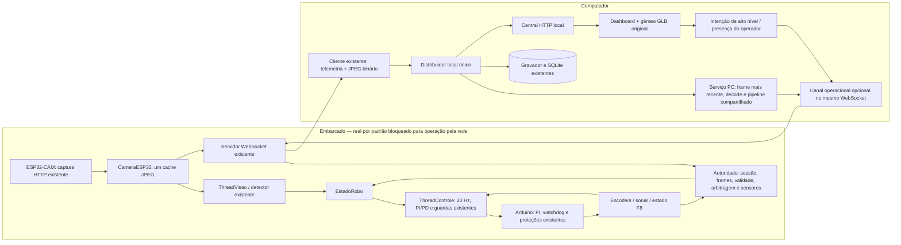
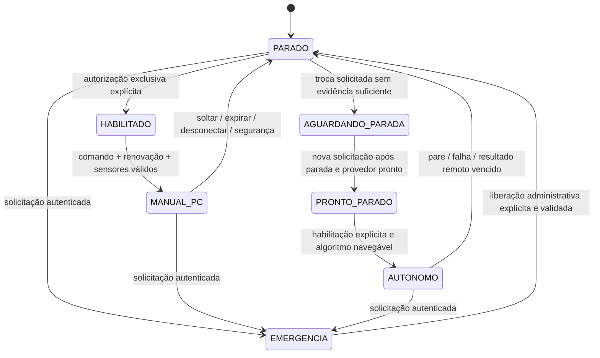

# Etapa 6 — processamento distribuído e controle remoto

Entrega de software de26/11/2026, desenvolvida/testada no Windows. A Raspberry,
ESP32-CAM, Arduino e deslocamento físico não foram usados nesses ensaios.
Nenhum firmware, pino, ganho PI/PD, rede da câmera ou serviço Linux foi alterado.
O objetivo da próxima validação é verificar esta cadeia no hardware, não
declarar autonomia física a partir dos testes virtuais.

## Arquitetura e responsabilidades



Em **embarcado**, a percepção permanece na Raspberry e independe do dashboard.
Em **distribuído**, o PC recebe os JPEGs existentes, executa percepção e retorna
resultados; a Raspberry conserva a decisão de permitir movimento, os sensores
e o controlador. A thread de visão local pausa somente enquanto esse
processamento está transferido. Não há fallback automático para outro algoritmo.

**Simulado** é o ambiente de execução: permite experimentar os dois modos
anteriores no PC. `RuntimeSimulado` reutiliza o gerador/captura e o cenário
anteriores; usa o `EstadoRobo` e a `ThreadControle` reais com motor/sensores
virtuais. O controle de baixo nível do Arduino é representado por uma resposta
virtual aos alvos, não por simulação física validada do PI. O algoritmo OpenCV e
as operações NumPy da CNN executam de verdade. Não são números gerados no gráfico.

Não há segundo dashboard, GLB, banco, cliente de imagens, aquisição HTTP da
ESP32 ou escritor concorrente de motores. O serviço PC assina o mesmo bus.
O controlador nunca espera uma resposta de rede para completar seu ciclo.
No software embarcado, somente `controle.py` converte intenções em comandos;
os callbacks imediatos de voz/Bluetooth existentes continuam nesse módulo.
O novo canal de rede nunca chama serial, GPIO ou PWM.

## Levantamento do projeto preservado

- Telemetria/benchmark: `monitoramento/`, amostras SO e tempos já existentes.
- Transporte: `comunicacao/{servidor,cliente,protocolo,distribuidor}.py`,
  canais independentes de telemetria e JPEG; agora canal operacional opcional.
- Aquisição: `CameraESP32` compartilhada com painel de coleta e visão.
- Visão atual: `DetectorLinha(tracejado=True)`, orientação, ROI, cinza,
  GaussianBlur, Otsu/limiar configurado, abertura morfológica e geometria
  tracejada existentes. Parâmetros preservados. Hough existe como referência
  offline e não foi promovido a algoritmo padrão de navegação nesta etapa.
- CNN: `RedeLinha` NumPy, três convoluções 5×5/2,3×3/2,3×3/2, ReLU e duas
  densas; entrada1×40×80, saída de posição tanh em−1..1. Variante BatchNorm
  carregada conforme o checkpoint. Pesos `.npz`, sem pickle.
- RL: pacote pareado existente Q/DQN/PPO, onze ações e contratos de observação
  próprios, inferência determinística; nenhum checkpoint operacional local.
- Controle: PI no perfil atual do Uno, PD e validade/memória visual na Pi,
  voz, Bluetooth, watchdogs, encoders, proteção/inspeção de obstáculos.
- Histórico: SQLite/WAL, gravador, sessões, experimentos, consultas, CSV e replay.
- Central/3D: os mesmos módulos das etapas4/5, materiais/eixos/pivôs preservados.

Não foram usados YOLO, MobileNet ou outros modelos prontos para substituir
a CNN. Não foram instaladas dependências de treinamento ou renderização na Pi.

## Contrato e validação de percepção

Envelope de transporte permanece v1. O acréscimo é opt-in e tem contrato de
payload próprio `robo_distribuido_v1`, em `/ws/operacao`, no mesmo servidor.
Clientes observacionais antigos continuam usando seus canais sem comandos.

Exemplo estrutural, sem credenciais:

```json
{
  "versao": 1,
  "tipo": "inferencia",
  "sessao": "UUID da sessão operacional na Raspberry",
  "sequencia": 42,
  "origem": "computador",
  "simulado": true,
  "dados": {
    "contrato": "robo_distribuido_v1",
    "geracao": 3,
    "sessao_visao": 2,
    "frame_id": 101,
    "inferencia_id": "UUID da inferência",
    "resultado": {
      "algoritmo": "opencv",
      "versao_modelo": "opencv_tracejado_existente_v1:<assinatura>",
      "posicao": 0.2,
      "erro": 0.2,
      "linha_visivel": true,
      "confianca": 0.8,
      "direcao": 0.0,
      "escala_direcao": 0.75,
      "processamento_s": 0.01,
      "inferencia_s": 0.009,
      "preprocessamento_s": null,
      "navegavel": true,
      "motivo": "geometria do detector existente"
    }
  }
}
```

Os números acima apenas ilustram o formato. Timestamp UTC e monotônico estão
no envelope existente. O monotônico do PC não é subtraído do monotônico da Pi.
Não há confiança artificial: no OpenCV ela é heurística geométrica; na CNN de
fotos é NULL. OpenCV preserva a orientação/normalização e o controlador conserva
seus ganhos. A versão OpenCV inclui assinatura dos parâmetros de ROI/orientação/limiares e
da implementação do detector/associador; diferenças entre PC e Pi impedem
a prontidão do fornecedor. Finais de linha Windows/Linux são normalizados
para essa assinatura. O pipeline acoplado do OpenCV expõe tempo total; não inventa uma
separação de pré-processamento que o detector original não instrumenta.

A Pi guarda até64 frames encaminhados, com o horário **original de recepção na
Pi**, idade inicial de captura, geração da câmera, sessão visual e geração de
modo. Ao receber, valida autenticação/permissão, contrato, sessão, sequência,
frame conhecido, ordem de frames, origem/domínio, geração, algoritmo/versão,
tipo/faixas/valores finitos e idade. Exige metadados OpenCV completos antes de
publicar uma leitura no controlador. Rejeição não renova validade nem inventa
uma observação. Resultado já em trânsito na troca de modo é descartado.

O ciclo Pi→PC→Pi é medido pelo relógio local da Pi, da recepção do frame ao
retorno aceito. Idade do resultado inclui também o limite inicial de idade
informado pela câmera. Esses conceitos são registrados separadamente.
Não se afirma latência unidirecional sem sincronização. O RTT do canal
operacional mede ida, processamento da mensagem e confirmação no PC.

## Filas, desempenho e falhas

Filas do assinante de inferência e de resultados têm capacidade1; mensagens
antigas são substituídas. Comandos têm fila16, prazo local e prioridade para
parada/emergência. Uma mensagem de movimento em trânsito precisa ainda ecoar
um desafio emitido pela Pi e não expirado no relógio da Pi. Reconexão limpa
intenções, autorização, buffers/resultado e identidade anteriores; não reenvia
movimentos. A recepção de telemetria/imagens não depende do tempo da inferência.

O decodificador PC guarda no máximo uma matriz recente. O pipeline usa essa
matriz, evitando novo decode para cada algoritmo. Não executa OpenCV e CNN
simultaneamente como fornecedores ativos. A aquisição ESP32 existente ainda
decodifica seu cache na Pi para compatibilidade com os consumidores antigos;
não se afirma eliminação desse custo. O cinza de diagnóstico é opcional e de
baixa frequência. Renderização continua no navegador, inferência em worker PC,
SQLite no gravador existente; nenhuma dessas tarefas passa para a Raspberry.

Padrões de ensaio: inferência5 Hz, JPEG5 FPS, câmera virtual30 FPS,
telemetria10 Hz, controle20 Hz. Resultado até0,3 s, comando até0,3 s,
autorização até0,6 s e heartbeat de percepção a0,15 s. Alvo manual PC máximo
4 pulsos/s. São limites conservadores configuráveis, não frenagem/calibração
física comprovadas. A validade visual de0,3 s já pertencia ao projeto.

Em distribuído, falta de resultado válido, heartbeat, câmera ou sensores
interrompe a autorização e solicita parada. Falha de inferência explícita também
para. Não muda automaticamente para OpenCV/local enquanto há movimento.
Perda do PC não interrompe a autonomia **embarcada** por dependência artificial.

## Arbitragem, estado e parada

Processamento (`embarcado/distribuido`) é distinto de operação
(`parado/manual/autonomo`) e origem (`pc_manual`, Bluetooth, voz, autônomo,
segurança). Não há duas autorizações simultâneas de movimento.

Prioridade: emergência/guardas embarcadas; parada de voz; novo pedido manual
Bluetooth; autoridade PC ou autonomia selecionada. Bluetooth preempta e
invalida uma autorização PC. O PC não assume enquanto outra operação estiver
ativa; exige parada e nova habilitação. O bypass de sonar do Bluetooth que já
existia **não** é usado no novo modo `REMOTO_PC`: controle PC exige sensores
frontais válidos e sem bloqueio, inclusive para as manobras virtuais.

Voz e Bluetooth no modo embarcado conservam o caminho atual. No distribuído,
voz `pare` continua prioritária; outros comandos de voz são recusados nessa
integração. A transferência para autonomia distribuída exige a solicitação
explícita e o provedor pronto. Essa restrição é deliberada e não altera o
Bluetooth existente nem o comportamento padrão embarcado.



A troca solicita parada, espera evidências disponíveis, limpa comandos e
percepção, avança a geração, valida a nova fonte e mantém movimento desarmado.
Há intervalo mínimo entre trocas, sem alternância automática. Quando a primeira
solicitação apenas inicia a parada, o operador deve aguardar e solicitar novamente.

Parada é diferenciada em solicitação, aceitação, confirmação pelos dados e
falha de confirmação. A confirmação requer estado PARADO, F8 recente com PWM
informado zero e contadores de encoder estáveis por pelo menos0,1 s. Não é
medição independente de velocidade/frenagem. Após2 s sem evidência, indica
falha de confirmação. Emergência é retida no objeto da sessão operacional e
sobrepõe voz, Bluetooth e PC; não substitui botão físico.

## Autenticação e permissões

O bearer observacional anterior não dá acesso operacional. O canal exige
também credenciais distintas de percepção, controle e/ou administração em
cabeçalhos próprios. Permissões: monitoramento/consulta pelos canais/HTTP
existentes; resultados/heartbeat por `percepcao`; intenções por `controle`;
troca de modo/algoritmo e liberação de emergência exigem administração também.

Variáveis: `ROBO_REDE_TOKEN`, `ROBO_TOKEN_PERCEPCAO`, `ROBO_TOKEN_CONTROLE`,
`ROBO_TOKEN_ADMINISTRAR`. Os tokens são definidos pelo operador, com pelo menos
24 caracteres ASCII, distintos por privilégio. Não são enviados em URL nem
gravados no histórico. No simulador são gerados novos tokens efêmeros.
Cada aba possui identidade própria; o backend não compartilha uma autorização
manual entre duas abas. Nenhuma aba recebe a credencial de rede.

Mensagens são limitadas em tamanho e frequência (80/s no canal operacional),
sem JSON duplicado/NaN/Infinity. Dados com sequências repetidas são recusados.
HTTP continua em127.0.0.1, com token efêmero/Host/Origin e corpo limitado.
Não existe acesso direto a serial, GPIO, ponte H, SQL ou PWM pela API.

O transporte atual é WS em IP privado explícito. **TLS nativo não foi
implementado**; numa rede não confiável, usar somente após preparar/validar
isolamento ou túnel seguro. Tokens em WS não fornecem criptografia. Nenhuma
porta de roteador, firewall ou serviço público foi aberta automaticamente.

## CNN própria e RL: disponibilidade e limites

O treino02 existente foi efetivamente carregado: hash `c3a865f28c9de7ff`,
entrada1×40×80 e pré-processamento `foto_roi_2por1_y075_v1`. O carregador
verifica arquivo, arquitetura, formas, valores finitos, hash e metadados.
Não há inferência com pesos aleatórios de fallback.

Esses pesos representam posição horizontal em y75%, não ângulo de motor.
A visibilidade não foi supervisionada. Sua ROI não cabe na imagem320×240;
não é adaptada silenciosamente. O modo `cnn-fotos` funciona para diagnóstico
com imagem compatível, retorna posição real entre−1 e1, mantém confiança/
visibilidade/erro de controle como NULL e não permite seguimento com esses pesos.

RL reutiliza `Pacote` e sua verificação de hashes, CNN pareada, onze ações,
escalas e Q/DQN/PPO determinísticos. Q usa observação discretizada de erro,
delta, velocidade, idade e ação anterior; DQN/PPO usam vetor de sete valores.
A inferência só escolhe ação quando há observação explicitamente fornecida,
sem inventar velocidade calibrada. A interface registra a pendência: não há
checkpoint RL local. O adaptador permanece diagnóstico; navegação remota RL
não foi habilitada. DQN/PPO continuam exigindo dependência opcional existente,
não instalada por esta etapa. Não houve treino, exploração ou atualização online.

## Dashboard e gêmeo digital

Nova página **Controle remoto**, mantendo as14 anteriores: autorização,
direções por pressão contínua, velocidade em PPS, teclado, presença, parada,
emergência/liberação, seleção de modo/pipeline e ensaios de falha.
O seletor não habilita movimento sozinho. Digitação em campos é ignorada pelos
atalhos; `blur`, `visibilitychange`, `pagehide`, soltura/cancelamento do ponteiro
e mudança de página liberam/zeram conforme a situação. A garantia final de
expiração está na supervisão da Pi, não no navegador.

Visão geral, IA, desempenho, comunicação e gêmeo recebem o resumo de estado
e o fluxo da rota ativa, sem animação que finja atividade. O PC aparece como
etapa externa no fluxo distribuído; não é inserido no GLB. A Raspberry original
pode ser selecionada para inspeção. O gêmeo segue telemetria, nunca gera comandos.
O GLB, materiais, pivôs/eixos e animações permanecem os mesmos.

Métricas do serviço mostram inferência, posição/erro quando existentes,
contadores, filas, resultados rejeitados, idade, ciclo completo e estatísticas.
Média/mediana/mínimo/máximo/desvio/p95/jitter usam janela de até512 amostras;
p99 só com pelo menos100. CPU do processo Windows não é CPU da Raspberry.
A configuração do modo embarcado/simulado não fabrica medições de GPU, temperatura
ou desempenho físico. Ausências e falhas permanecem identificadas.

## SQLite e exportação

Migração cumulativa **v5**, na mesma base/gravador:

| Tabela | Conteúdo |
|---|---|
| `percepcao_remota` | Uma projeção por telemetria: processamento, operação, autoridade, algoritmo/versão, frame, geração, fase, emergência, parada, idade/ciclo, tempos, posição/erro/confiança e contadores; JSON de origem preservado |
| `operacao_rede_eventos` | UUID por evento, sessão, UTC, tipo, simulado, motivo e detalhes; deduplicação e índice temporal |

Tempos em segundos, posição/erro normalizados, ausência em NULL. `telemetria_id`
liga a projeção aos dados de sensores, motores e desempenho já existentes.
Eventos incluem mudanças de modo, pedidos/aceitação/confirmabilidade de parada,
autorização, resultados aceitos/rejeitados e falhas. Tokens, desafio e autorização
privada não são inseridos nessas tabelas.

Categorias CSV novas: `percepcao_remota`, `operacao_rede_eventos`, disponíveis
no mesmo exportador e seletor de categorias do resumo de sessão. Metadados de
experimento existentes guardam resolução/FPS/modo/modelo/rede/controladores,
velocidade/condições/repetição. Não foi criada segunda infraestrutura analítica.
As sessões antigas são preservadas. Eventos são buffers limitados durante uma
interrupção: não se promete trilha durável ilimitada na Pi.

Resumo/comparação de sessões também incluem ciclo distribuído e tempo de
inferência, além dos processamentos efetivamente registrados. São estatísticas
das projeções amostradas por telemetria, excluindo resultado vencido/NULL;
não equivalem a repetições experimentais independentes. Cada ocorrência de
resultado fica ainda disponível na categoria de eventos para outra ponderação.

API adicional: `POST /api/central/operacao`, protegida pelo HTTP local existente.
Ações: `habilitar`, `movimento`, `parar`, `liberar`, `emergencia`,
`liberar_emergencia`, `modo`, `siga`, `configurar_pipeline`, `imagem_teste` e
`falhas_servico`. Inclui instância/geração do frontend e UUID da aba; comandos
antigos de outra origem são descartados. Imagem/falhas são exclusivas da
simulação; não são rotas de firmware ou configuração de rede do carrinho.

`tools/inferir_historico_distribuido.py` executa o pipeline em JPEGs históricos
com hash validado e exporta CSV/JSON, sem rede/motor/treino. Usar a mesma sessão
e arquivos permite uma comparação posterior controlada. Replay não responde às
ações de um agente e não é apresentado como ambiente de treinamento RL.

## Instalação e execução

Sem dependências de execução novas. Reutiliza Python, NumPy/OpenCV, psutil,
websockets, SQLite e Three.js fixado pelo lockfile anterior.

```powershell
.\instalar_central.ps1
.\iniciar_distribuido.ps1
.\iniciar_distribuido.ps1 -Perfil simulacao-distribuida
```

O primeiro perfil usa percepção embarcada virtual; o segundo faz o circuito
JPEG→PC→resultado, ambos parados. Não executar os dois simultaneamente na mesma
porta/base. `Ctrl+C` encerra HTTP, cliente, serviço de inferência, simulador e
gravador. As dependências de GLB/Three.js são as anteriores. `iniciar_central.ps1`
e `iniciar_gemeo.ps1` continuam disponíveis para os modos anteriores.

Frequências/timeout e endereço podem ser passados pelo script; ver README.
`-Historico` escolhe raiz existente, sem duplicar banco. O perfil real de
distribuição é recusado sem registro de aprovação física fornecido explicitamente.
`distribuido/validacao_fisica.exemplo.json` não é aprovação e não habilita nada.
O registro manual é decisão do operador após os ensaios, não certificação automática.

Comandos futuros na Pi, com um único serviço/controlador usando o Arduino:

```bash
# Definir os tokens distintos no ambiente, fora do código e dos registros.
python3 main.py --rede --rede-host IP_PRIVADO_DA_PI --operacao-rede
```

Sem `--validacao-fisica`, atuação de rede permanece bloqueada. Para o modo real
aprovado futuramente, o mesmo registro deverá ser explicitamente selecionado
na Pi e no PC; credenciais não são conteúdo desse registro.

```powershell
.\iniciar_distribuido.ps1 -Perfil monitoramento -Servidor 'ws://IP_PRIVADO_DA_PI:8765'
# Somente depois dos ensaios e aprovação explícita:
.\iniciar_distribuido.ps1 -Perfil distribuido-real -Servidor 'ws://IP_PRIVADO_DA_PI:8765' -ValidacaoFisica 'C:\registros\validacao_fisica.json'
```

Não foi executado nenhum desses comandos físicos, regravado firmware ou
reiniciado serviço da Pi nesta entrega.

## Rede e validação física progressiva

A ESP32 conserva seu ponto de acesso. Reutilizar rede compartilhada, Ethernet
de bancada ou segundo adaptador conforme o guia19. Não presumir comunicação
entre clientes do AP da ESP32. Conferir IP/rotas (`ip addr`, `ip route`), acesso
ao endpoint de câmera existente, porta do servidor e sondas RTT. No Windows,
`Test-NetConnection IP_DA_PI -Port 8765` verifica TCP, não aprovação de controle.
Medir estabilidade e capacidade com telemetria/JPEG antes de movimentar.
Nenhuma interface, Wi-Fi, firewall ou roteador é configurado automaticamente.

| Ordem | Ensaio posterior | Critério para avançar |
|---|---|---|
| 1 | Alimentação elétrica | Sem reinícios/subtensão nos ensaios e instalação revisada; limites conforme o hardware já documentado |
| 2 | Arduino e serial | Uma única main/serial, F8/sensores recentes, sentidos e watchdog conferidos com rodas suspensas |
| 3 | ESP32-CAM | JPEG correto, orientação/resolução/idade verificadas, captura compartilhada com coleta |
| 4 | Rede PC↔Pi | IP/rotas e acesso bidirecional verificados na topologia escolhida |
| 5 | Telemetria real | Sessão/domínio/seq, valores e vencimento correspondem ao observado |
| 6 | Imagens no PC | IDs/idade/resolução coerentes, sem fila crescente ou segunda captura |
| 7 | Inferência sem movimento | Rodas sem autorização, saídas/modelo/contrato corretos; CNN offline permanece diagnóstico |
| 8 | Equivalência local/remota | Mesmos JPEGs e parâmetros; diferenças investigadas e dentro da tolerância registrada |
| 9 | Latência | Ciclo local da Pi/p95/jitter medidos sob carga e compatíveis com validade; não estimar sentido único por relógios distintos |
| 10 | Resultados antigos | Frame/session/generation/seq antigos recusados sem renovar prazo |
| 11 | Controle com rodas suspensas | Habilitação exclusiva, baixos alvos, soltar/timeout/foco param; sem PWM direto PC |
| 12 | Perda de comunicação | Parada por expiração no embarcado, mesmo com navegador travado; reconexão não retoma |
| 13 | Emergência por software | Retida; novos movimentos bloqueados; liberação exige nova ação e evidências |
| 14 | Bluetooth↔PC | Preempção e transferência explícitas, um único escritor, bypass Bluetooth não transferido ao PC |
| 15 | Troca de modos | Parada/evidências/limpeza/geração novas; sem retomada automática |
| 16 | Obstáculos/sensor | Obstáculo, eco inválido e telemetria antiga não viram caminho livre; guardas do firmware preservadas |
| 17 | Calibração | PPR/diâmetro/bitola/orientação/ROI/velocidade/frenagem/validades medidos e registrados |
| 18 | Baixa velocidade no piso | Área controlada, resposta consistente e parada verificada; não aumentar ganhos por esta etapa |
| 19 | Seguimento | Linha/perda/curvas/câmera/encoder e parada verificados com o algoritmo realmente aprovado |
| 20 | Comparação de modos | Mesmas condições/imagens/repetições, modos identificados, sem concluir superioridade por este benchmark Windows |

Qualquer falha impede avançar. A confirmação por telemetria não substitui
observação independente da parada. Ajustes de ganhos, firmware ou nova tarefa
CNN não foram autorizados/realizados por esta implementação.

## Testes e resultados efetivamente obtidos

Regressão selecionada: **468 aprovados,1 ignorado,4 desmarcados e56
subtestes**,86,41 s. São46 casos novos da etapa6, incluindo rejeição de
dimensões JPEG excessivas antes da decodificação e equivalência do JPEG
que atravessou a rede. Após reforçar a assinatura OpenCV e correlação das
confirmações, os46 casos da etapa6 passaram novamente em8,03 s. A verificação
dirigida de central/etapa6 teve59 aprovados em23,24 s; incluindo armazenamento,
87 aprovados em31,68 s. Testes JS:15 aprovados, incluindo campos de texto,
soltura, foco e página oculta. São ensaios de software Windows; as exclusões
legadas/hardware são as mesmas documentadas nas etapas anteriores. A suíte
completa de hardware não foi executada.

Interface verificada a1440×1000 e390×844: habilitação/liberação, ausência de
movimento ao digitar, emergência retida/liberação explícita, carregamento da
CNN própria/imagem compatível, bloqueio de seguimento com CNN offline e
seleção da Raspberry no GLB original. Um único canvas, sem transbordamento
horizontal na tela estreita. Consulta de console sem erros/avisos. Capturas
em `dados_distribuido/etapa6/` (artefatos locais fora do Git).
Inferência histórica adicional:6 JPEGs de uma sessão simulada anterior,
zero falhas,0,059 s totais; sem rede/atuação/treinamento.

Cobertura: startup sem movimento, tokens/papéis/desafio, duplicatas/gerações,
frame conhecido/idade/ordem, NaN/faixas/tipos, validade original, exclusividade,
dead-man, Bluetooth/voz/emergência, sensores/Arduino, mudança de modos,
desconexão sem retomada, filas e ciclo real WebSocket→percepção→ThreadControle→
motor virtual→telemetria/SQLite. O teste integrado verificou que a autoria de
escrita das referências virtuais era somente a thread `controle`.

Equivalência: três JPEGs sintéticos fixos640×480, SHA256 registrado, OpenCV e
CNN carregada dos pesos próprios. Diferenças observadas **zero** em posição,
erro, entrada/ROI e campos comparáveis; tolerância float1e−6. NULL é comparado
como ausência, não zero. Teste adicional compara o JPEG que efetivamente
atravessou o WebSocket com o processamento local. Não mede acurácia na pista.

Hardware do ensaio: Windows11 build26300, Intel64 Family6 Model142 Stepping12,
8 processadores lógicos, aproximadamente7,84 GiB de RAM. Medições abaixo são
do PC, com6 s por configuração, central/SQLite/consultas simultâneas e gêmeo
visível. CSV/JSON e imagens em `dados_distribuido/validacao_20261126T050953Z/`.

| Ensaio | Imagens / telemetria / alvo de inferência | Inferência observada | Processamento PC médio | Ciclo Pi virtual→PC→Pi médio / p95 |
|---|---|---|---|---|
| OpenCV padrão320×240 | 5 FPS /10 Hz /5 Hz | 4,98 Hz | 11,13 ms | 76,28 /104,82 ms |
| OpenCV carga320×240,2 consumidores locais lentos | 15 FPS /30 Hz /10 Hz | 10,06 Hz | 11,82 ms | 123,61 /169,28 ms |
| CNN própria diagnóstico640×480 | 5 FPS /10 Hz /5 Hz | 5,16 Hz | 7,99 ms | 92,27 /134,08 ms |
| Sobrecarga com400 ms de atraso provocado | 15 FPS /30 Hz /10 Hz | 0 resultado válido | Indisponível | Indisponível |

O último caso descartou15 frames vencidos antes de inferir e67 intermediários
do assinante, mantendo fila de frames≤1 e resultados≤1. Na carga OpenCV houve
25 substituições de frames. Nenhum erro SQLite nesses quatro ensaios. Contadores
genéricos de descarte do gravador incluem JPEG desativado/política e dados fora
da gravação, não representam perda de telemetria automaticamente.

RSS máximo do processo: aproximadamente79,1/82,3/87,9/85,7 MiB por caso.
CPU média do processo:71,8/97,4/76,6/64,1% na convenção psutil que soma núcleos;
não é uso total do computador nem CPU da Raspberry. Amostras do render
informaram60 FPS e média CPU/submissão6,19–6,46 ms, canvas470×398. Não é tempo
GPU. Os percentis/tempos completos, contadores, configuração e exportações estão
no JSON. Amostras pequenas não justificam p99; ele ficou NULL nesse ensaio.

Não conclui que CNN/distribuição sejam superiores: imagens/tarefas e configurações
não são um experimento físico controlado de seguimento. O benchmark mede o
software neste PC, não frenagem, estabilidade ou desempenho térmico da Pi.

## Classificação da entrega e preparação da etapa7

| Funcionalidade | Classificação |
|---|---|
| Canal operacional, sessão/seq/frame, validação e filas | Implementada e testada em simulação |
| Percepção OpenCV distribuída e controle20 Hz existente | Implementada e testada em simulação |
| Dead-man, exclusividade, teclado, emergência e arbitragem | Implementada e testada em simulação; não certifica segurança física |
| Dashboard/gêmeo/SQLite/CSV e instrumentação | Implementada e testada em simulação |
| CNN própria com pesos existentes e imagem compatível | Implementada e testada em simulação/diagnóstico, sem navegação |
| Acoplamento opcional na main da Raspberry | Implementada e aguardando validação física; atuação real bloqueada por padrão |
| Parâmetros físicos, rede/topologia, parada/F8 e controladores no piso | Implementada e aguardando validação física/calibração |
| CNN offline como percepção navegável320×240 | Não implementada: contrato/visibilidade incompatíveis; exige tarefa e validação próprias |
| Adaptador CNN/RL | Parcialmente implementada: reutiliza pacote/inferência; controle distribuído RL bloqueado |
| Ensaio de Q/DQN/PPO com checkpoints operacionais | Bloqueada por dependência externa: arquivos RL locais ausentes; DQN/PPO exigem dependência opcional existente |
| Latência unidirecional/captura física/frenagem | Bloqueada por medição física/sincronização; não inventada |
| TLS nativo, retorno automático de algoritmo, treino contínuo real | Não implementada nesta etapa; fallback/treino permanecem desabilitados |
| Comparação científica de embarcado×distribuído na pista | Não implementada: preparada para etapa7 por registros e protocolo de ensaio |

A etapa7 pode usar sessões/experimentos/imagens idênticas, configurações,
perfis e estatísticas registrados para uma comparação controlada após aprovação
física. Não foi iniciado treinamento, otimização automática de ganhos ou estudo
de superioridade. O sistema não gera conclusões científicas automaticamente.

## Arquivos e mudanças

Criados: `distribuido/{configuracao,autoridade,canal,percepcao,servico,simulacao,
metricas,contratos}.py`, README e exemplo de validação sem aprovação;
`central_monitoramento/frontend/src/operacao.js`, testes JS de presença;
`tests/test_distribuido.py`; `iniciar_distribuido.ps1`;
`tools/{validar_distribuido,inferir_historico_distribuido}.py`; este guia.

Alterados: servidor WebSocket existente; integração da Ponte/Fluxo; central
HTTP/backend e páginas/estilos; `estado.py`/`controle.py` com ramo opt-in de
referência PPS; `main.py` com canal desabilitado por padrão; pausa opt-in dos
workers locais; telemetria/benchmark; migração/projeção/consultas de dados;
CLI e documentos de continuidade/dicionário. As expectativas de versão nos
testes anteriores acompanham a migração preservadora. Nenhum push.
