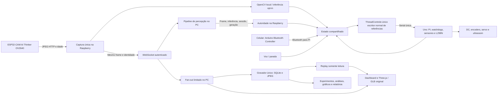
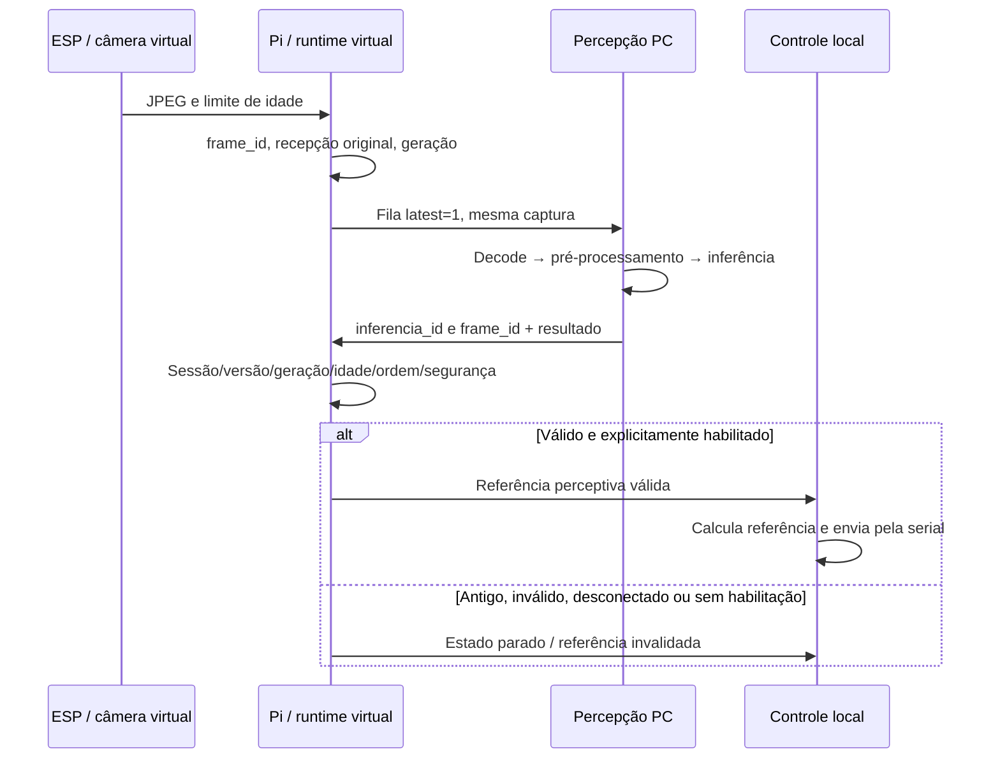
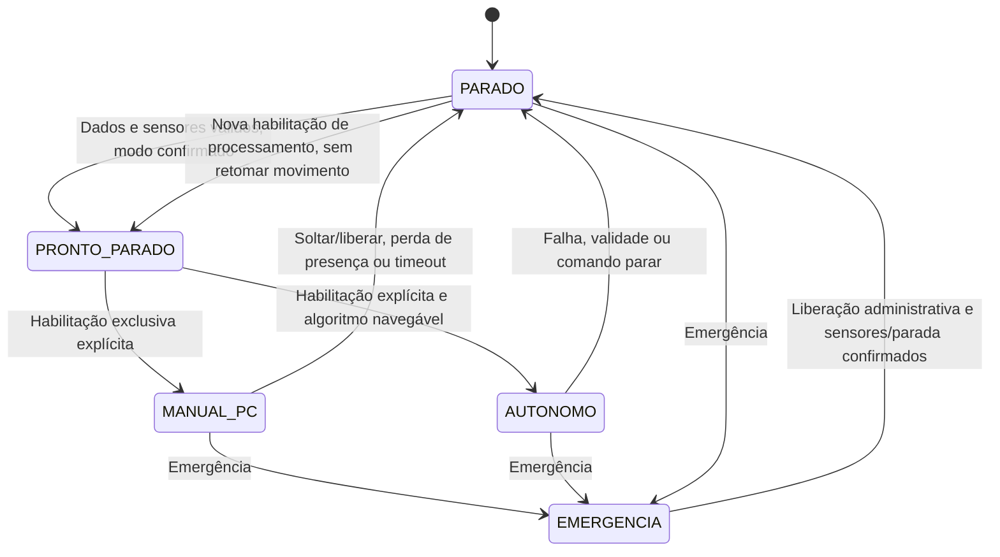
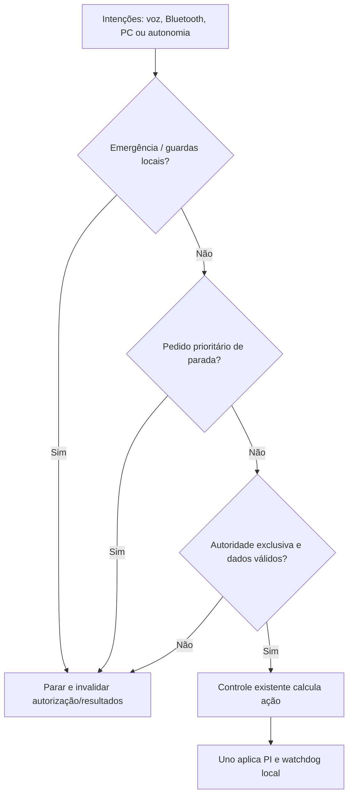
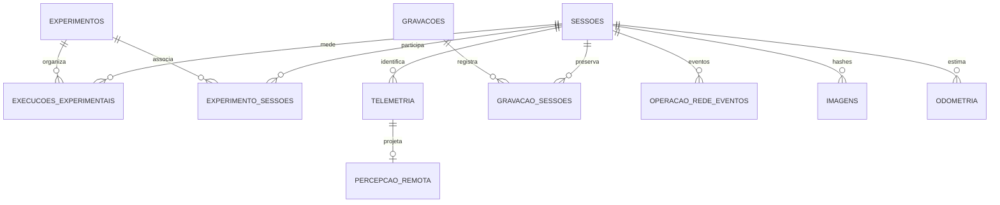
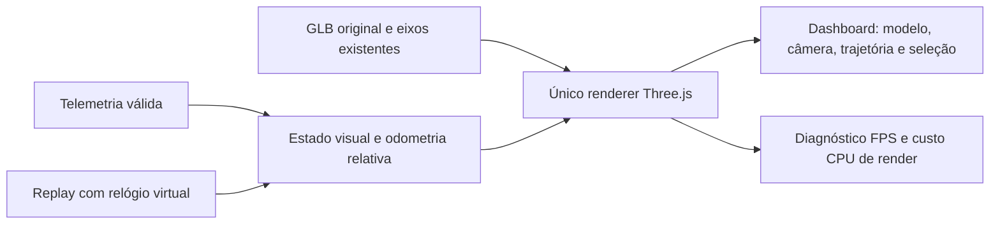

# Arquitetura final e rastreabilidade

## Sistema e responsabilidades

Desenho preparado para real. Nesta entrega executam-se **Pi/Uno/ESP virtuais no
PC**. CNN02 e RL permanecem diagnósticos/bloqueados conforme os contratos;
não é uma declaração de navegação física integrada validada.

## Fluxo de imagem e inferência

## Estados e arbitragem

O perfil Bluetooth legado sem ultrassom é uma exceção explícita da montagem
anterior, documentada no guia07/24; não aplicar esse bypass ao PC. Parada física
não é comprovada por transição de estado ou PWM zero na telemetria.

## Banco e visualização

## Método experimental

```mermaid
flowchart LR
 Q[Questão e hipótese] --> PL[Plano versionado e critérios]
 PL --> B[Blocos aleatórios de repetições]
 B --> W[Inicialização e aquecimento separados]
 W --> C[Coleta identificada no mesmo SQLite]
 C --> I[Integridade e evidências]
 I --> A[Análise por execução e gráficos]
 A --> H[Interpretação humana e limitações]
 H --> F[Validação posterior N4/N5]
```

## Matriz de rastreabilidade dos 40 requisitos

| Requisito | Implementação / documento | Verificação / situação |
|---|---|---|
| 1 Auditoria completa | guia25, tools/auditar_projeto | inventário AST/hash + revisão por subsistema; execução física pendente |
| 2 Questões científicas | guia26 | nove questões relacionadas às hipóteses; nenhuma conclusão prévia |
| 3 Hipóteses | tabela H1–H8 guia26 | variáveis, controles, procedimento, dados/limites documentados |
| 4 A–D/RL | configuracao.CONFIGURACOES e executor | A–D N3; B/D diagnósticos; RL bloqueado por checkpoint |
| 5 Padronização | PADRAO, ambiente e manifestos | config/seed/hash/versões, aquecimento e carga separados |
| 6 Níveis | origem/nivel/categoria no esquema v6 | validação rejeita executor real; comparação rejeita mistura |
| 7 Recursos | monitoramento/Sistema e Benchmark reutilizados | CPU/RSS reais PC, threads; GPU/energia/Pi física indisponíveis |
| 8 Visão | experimentos.visao | mesmos77 frames revisados, velocidade separada de qualidade |
| 9 CNN | visao/analise e pesos originais |55.090 parâmetros, hash; MAE/MSE/RMSE/R², resíduos, split vídeo/hash |
| 10 RL | loaders/ambientes existentes + guia26 | testes próprios; não executar treino online; avaliação integrada pendente |
| 11 Comunicação | Cliente/Servidor/metricas e snapshots | RTT/filas/contadores; scripts carga existentes; sem one-way não sincronizado |
| 12 Latência completa | frame/inferência IDs e eventos Etapa6 | ciclo Pi virtual→PC→Pi virtual; passos não observados NULL; motor físico pendente |
| 13 PI/PD | analise.resposta_degrau; harness existente | métricas testadas; ganhos/firmware intactos; resposta física pendente |
| 14 Linha | regressão vs referência externa + guia26/27 | saída em imagem não cm; conclusão/percurso físicos não medidos |
| 15 Dez cenários | guia27 faseJ | falhas virtuais em suite; curvas/pista físicas preparadas |
| 16 Odometria | cinematica existente, analise.odometria | referência pareada, orientação circular; calibração física pendente |
| 17 Gêmeo | renderer/GLB existentes, guia27L | carga/render/seleção/replay software; pivôs/sentidos físicos pendentes |
| 18 Dashboard | quinze páginas + experimentos.js | inspeção por navegador, ações/relatórios/filtros; testes JS |
| 19 SQLite | migração6 e writer único | integrity/FK, sessões independentes, CSV e testes backup/recovery anteriores |
| 20 Segurança | testes_distribuido/seguranca/etc | auth/ordem/validade/lease/falhas; teste novo cancelamento; não certifica físico |
| 21 Carga | carga_5min.json, duração configurável | ensaio300s;15/30/60min configuráveis, ainda não executados |
| 22 Executor | experimentos.executor + CLI/HTTP | UUID por repetição, fonte única, exclusão lógica, cancelamento e registro |
| 23 Repetições | shuffle por bloco/seed, SQLite |5 por A–D; mensagens internas não são unidade experimental |
| 24 Estatística | experimentos.analise | testes conhecidos para regressão/quantis/CI/zero; sem teste indiscriminado |
| 25 Arquiteturas | repositorio.comparar | médias por execução; condições/domínios checados, diferenças/speedup |
| 26 Gráficos | relatorios e visao + gráficos existentes | PNG240dpi/SVG de dados reais/sintéticos identificados; sem placeholders |
| 27 Experimentos UI | experimentos.js e página anterior | plano, repetições/filtros/comparação, evidências/replay/export |
| 28 Relatórios | relatorios.gerar | MD/HTML/CSV/JSON/ZIP; interpretação manual; PDF por impressão |
| 29 Organização | experimentos e ignore | fontes/config pequenos versionados; resultados na mesma raiz histórica |
| 30 Arquitetura | diagramas e auditoria25 | mesma captura/serial/controle/bus/writer/GLB; limites preservados |
| 31 Elétrica | guia27 checklist | não executado, sem alteração de hardware/pinagem |
| 32 Validação física | guia27 A–M | pré-requisitos/equipamento/comandos/critérios/falhas e registro |
| 33 Aprovação | analise.criterios + guia26 | limiares configuráveis e NULL não avaliado; físicos não inventados |
| 34 Suíte | tools/testes e conftest | unitários/integração/JS/segurança/carga/todos; falha legada explícita |
| 35 CI | workflow testes-software | preparado sem deploy; execução remota não realizada; suíte pode ficar vermelha |
| 36 Documentação | README, guias25–29, contexto13 | português, diagramas e separação software/real/proposta |
| 37 Scripts | iniciar_projeto + inicializadores existentes | central integrada, testes/experimentos/visão/relatório/instalação; Ctrl+C |
| 38 Manutenção | guia27 recuperação | backup/restauro em nova pasta, diagnóstico/fallback manual, sem rollback físico |
| 39 Restrições | diff e auditoria | firmware/pinos/ganhos/pesos/GLB/BT/coleta preservados; sem push |
| 40 Entrega | índice guia25 e resultados29 | artefatos locais, comandos, números observados e pendências |

O resultado detalhado dos casos está nos XML/JSON/logs em
`dados_experimentos/testes_*` e nos relatórios das execuções. Não há cobertura
de código anunciada nem certificação física. “Preparado” não significa “medido”.
